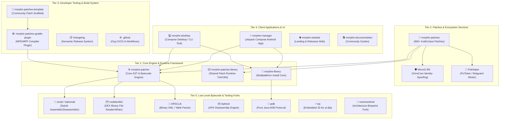

# All About Morphe 🌌
> **The Definitive Knowledge Base, Architectural Specification, and Technical Compendium for the Morphe Android Bytecode Patching Ecosystem.**

---

## 📖 Executive Summary

**Morphe** (hosted under [`MorpheApp`](https://github.com/MorpheApp)) is the next-generation, modular Android bytecode patching platform. Stemming from the architectural lineage of ReVanced, Morphe decouples application modification from static APK redistribution. Rather than distributing copyrighted, pre-modified binary binaries, Morphe distributes **instruction-level patch definitions** and **patch engines** that manipulate Android Dalvik/ART bytecode (`.dex`), binary XML resources (`resources.arsc`), and assets **entirely on the client device (or local desktop)**.

This repository, **All About Morphe**, is an exhaustive, encyclopedic documentation and whitepaper suite dissecting every single repository, protocol, data structure, bytecode transformation, and architectural layer in the Morphe ecosystem.

---

## 🏛️ The 5-Tier Morphe Ecosystem Taxonomy

The Morphe organization encompasses 21 interconnected repositories spanning reverse engineering, compiler plugins, UI clients, and runtime spoofing services:

---

## 🗂️ Table of Contents & Navigation Map

Explore the in-depth technical documentation categorized across the 6 major volumes:

### [Volume I: Architecture & Philosophy](docs/01-architecture-and-vision/)
- [**01. Ecosystem Overview & Philosophy**](docs/01-architecture-and-vision/01-ecosystem-overview.md): The legal, architectural, and reverse-engineering philosophy behind client-side patching.
- [**02. The 5-Tier Ecosystem Taxonomy**](docs/01-architecture-and-vision/02-five-tier-taxonomy.md): Complete repository matrix across all 21 repos with purpose, stars, technologies, and interfaces.
- [**03. End-to-End Patching Pipeline**](docs/01-architecture-and-vision/03-end-to-end-pipeline.md): Comprehensive sequence diagram from raw APK intake to signed, installed output.

### [Volume II: The Core Patcher Engine](docs/02-core-engine/)
- [**01. Morphe Patcher Internals**](docs/02-core-engine/01-morphe-patcher.md): Deep-dive into `Patcher`, `PatcherConfig`, AST matching, and lazy resource decoding.
- [**02. Morphe Patches Library**](docs/02-core-engine/02-morphe-patches-library.md): Injected runtime components: `ByteTrieSearch`, `StringTrieSearch`, `ResourceUtils`, and logging.
- [**03. Morphe Library (Install Engine)**](docs/02-core-engine/03-morphe-library.md): Cross-platform installation primitives: Root, Shizuku, ADB, and PackageInstaller.
- [**04. Patch Execution & Dependency Model**](docs/02-core-engine/04-patch-execution-model.md): DAG execution scheduling, `dependsOn`, `extendWith` (`.mpe` injection), and option schemas.

### [Volume III: Patches & Runtime Ecosystem](docs/03-patches-and-runtime/)
- [**01. Morphe Patches Catalog Analysis**](docs/03-patches-and-runtime/01-morphe-patches-catalog.md): Dissecting the 860+ Kotlin patches across YouTube, YT Music, Reddit, and universal system hooks.
- [**02. MicroG-RE & GMS Signature Spoofing**](docs/03-patches-and-runtime/02-microg-re-and-gms-spoof.md): Overcoming Google Play Services authentication boundaries without root privileges.
- [**03. PoToken & PotHelper Mechanics**](docs/03-patches-and-runtime/03-potoken-and-pothelper.md): YouTube Botguard / Play Integrity challenge solver and GMS Chimera service emulation.
- [**04. SponsorBlock & Return YouTube Dislike Integrations**](docs/03-patches-and-runtime/04-sponsorblock-ryd-integrations.md): Real-time crowdsourced segment skipping and dislike count injection.

### [Volume IV: Developer Tooling & Build System](docs/04-developer-tooling/)
- [**01. Morphe Patches Gradle Plugin**](docs/04-developer-tooling/01-morphe-patches-gradle-plugin.md): How `ExtensionPlugin`, `PatchesPlugin`, and `SettingsPlugin` build `.mpp` bundles and `.mpe` dex bytecode.
- [**02. Morphe Patches Template**](docs/04-developer-tooling/02-morphe-patches-template.md): Step-by-step scaffold for building independent community patch repositories.
- [**03. CI/CD & Semantic Release Pipeline**](docs/04-developer-tooling/03-release-and-ci-pipeline.md): Automatic versioning, changelog generation, and GitHub Releases distribution.
- [**04. The Definitive Patch Authoring Guide**](docs/04-developer-tooling/04-patch-authoring-guide.md): Hands-on masterclass: finding obfuscated method fingerprints and applying Smali bytecode mutations.

### [Volume V: Client Applications](docs/05-client-applications/)
- [**01. Morphe Manager (Android App)**](docs/05-client-applications/01-morphe-manager-android.md): Modern Android app built with Kotlin, Jetpack Compose, Material 3 Expressive, Room, Koin, and Shizuku.
- [**02. Morphe Desktop (CLI & GUI)**](docs/05-client-applications/02-morphe-desktop.md): Desktop cross-platform patching engine powered by Compose for Desktop and ADB automation.
- [**03. Morphe Website & Telemetry-Free Distribution**](docs/05-client-applications/03-morphe-website.md): Distribution architecture, Crowdin localization, and privacy guarantees.

### [Volume VI: Low-Level Bytecode & Tooling Forks](docs/06-low-level-internals-and-forks/)
- [**01. Smali & Multidexlib2 Internals**](docs/06-low-level-internals-and-forks/01-smali-and-multidexlib2.md): Low-level DEX format, 16-bit / 32-bit registers, and Morphe's customized upstream forks.
- [**02. ARSCLib & Binary Resource Manipulation**](docs/06-low-level-internals-and-forks/02-arsclib-and-resources.md): How `resources.arsc` chunk tables, XML string pools, and compiled IDs are mutated without recompilation.
- [**03. Apktool & JADB Integration**](docs/06-low-level-internals-and-forks/03-apktool-and-jadb.md): APK packaging pipeline and pure Java ADB socket protocol implementation.
- [**04. NowInAndroid Blueprint & EJS Runtime**](docs/06-low-level-internals-and-forks/04-nowinandroid-and-ejs.md): How Morphe adapted Google's flagship architecture and yt-dlp's JS runtime.

---

## 📖 The Community Wikis

### 👤 [User Wiki (Hands-On Handbook for Humans & AI)](wiki/user-guide/)
- [**01. Quick Start Guide**](wiki/user-guide/01-quick-start-guide.md): 5-minute zero-to-one guide to installing Morphe Manager, picking APKs, and applying patches.
- [**02. MicroG-RE & Account Setup**](wiki/user-guide/02-microg-and-account-setup.md): Complete setup for Google account login, 2FA, and disabling OEM battery optimization (Samsung, Xiaomi, OnePlus).
- [**03. Root vs. Non-Root Installation Modes**](wiki/user-guide/03-root-vs-non-root-modes.md): In-depth comparison and setup for Standard Non-Root, Shizuku (wireless debugging), and Root Bind Mount.
- [**04. Exporting, Importing & Keystores**](wiki/user-guide/04-exporting-importing-and-keystores.md): Safeguard against `INSTALL_FAILED_UPDATE_INCOMPATIBLE`, export patched APKs, and run batch patching.
- [**05. Troubleshooting & FAQ**](wiki/user-guide/05-troubleshooting-and-faq.md): Step-by-step remedies for video buffering at 1:00, package conflict errors, missing notifications, and car head-units.

### 🛠️ [Developer Wiki (High-Speed Patch Building)](wiki/developer-guide/)
- [**01. High-Velocity Patching Workflow**](wiki/developer-guide/01-high-velocity-patching-workflow.md): Rapid development lifecycle, Gradle daemon tuning, and sub-second unit test harnesses.
- [**02. Reverse Engineering Toolchain**](wiki/developer-guide/02-reverse-engineering-toolchain.md): Navigating R8 obfuscated APKs in JADX-GUI, finding invariant anchors, and Smali register inspection.
- [**03. Writing Lightning-Fast Patches**](wiki/developer-guide/03-writing-lightning-fast-patches.md): Performance engineering: zero-allocation render loops, using `ByteTrieSearch` over regex, and lazy decoding.
- [**04. Building & Publishing Patch Bundles**](wiki/developer-guide/04-building-and-publishing-patch-bundles.md): Compiling `.mpe` with D8, packaging `.mpp` containers via Gradle, and publishing to GitHub for Morphe Manager.
- [**05. App-Specific Playbooks**](wiki/developer-guide/05-app-specific-playbooks.md): Concrete opcode snippets and bytecode injection recipes for YouTube, YouTube Music, and Reddit.

---

## 🔄 Automated Upstream Tracking

This repository continuously monitors all 21 MorpheApp upstream repositories via an automated GitHub Actions cron workflow ([`.github/workflows/upstream-sync.yml`](.github/workflows/upstream-sync.yml)).
- **Live Ecosystem State:** Check [`upstream-manifest.json`](upstream-manifest.json) for currently tracked releases and SHAs.
- **Upstream History:** Check [`docs/upstream-changelog.md`](docs/upstream-changelog.md) for automated ecosystem shift logs.

---

## ⚖️ Legal & Security Framework

Morphe operates under a clean-room, strictly legal architecture:
1. **Zero Pirated Binaries:** Morphe hosts and distributes **0 bytes** of proprietary Google or third-party application binaries.
2. **Transformative Modifications:** Patches are open-source Kotlin/Java transformation scripts executing on user-supplied APKs.
3. **On-Device Sandboxing:** All patching operations occur locally on user devices; credentials and authentication tokens never transit remote servers.

---

*Maintained by the Open Source Android Engineering & Reverse Engineering Community.*
