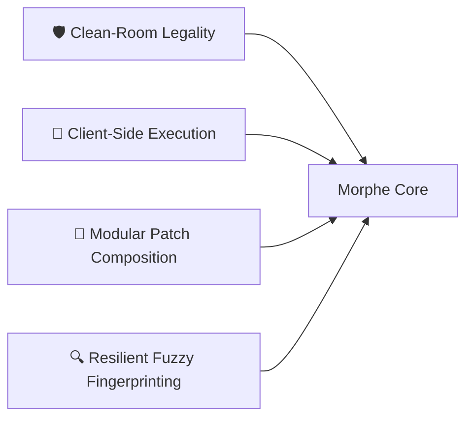

# Volume I: Chapter 1 — Morphe Ecosystem Overview & Philosophy

## 1. Genesis & Historical Context

The Android application ecosystem has long been characterized by proprietary client applications (such as YouTube, YouTube Music, Reddit, Twitter/X) that increasingly integrate telemetry, unskippable multi-segment video advertisements, algorithmic recommendations, and aggressive feature paywalls.

Historically, modding communities relied on pre-patched static binaries (such as Vanced), where maintainers decompiled an APK, patched smali files manually, re-signed the APK, and redistributed the modified APK through file hosters or custom downloaders.

This traditional paradigm suffered from two fatal architectural and operational flaws:
1. **Legal Fragility (Copyright Infringement):** Distributing proprietary binaries owned by Google or other entities violates copyright law, leading to Cease and Desist (C&D) notices and project shutdown.
2. **Maintenance Hell & Fragility:** Manual smali editing breaks whenever the target app updates even a minor version. Re-applying hundreds of smali modifications across tens of thousands of obfuscated classes is unsustainable.

### The Paradigm Shift: Dynamic Bytecode Patching
In response, the **ReVanced** ecosystem introduced the concept of **decoupled bytecode patching**:
- The toolmaker publishes **only the patcher engine** and **declarative patch transformation scripts**.
- The end-user provides their own legitimately obtained APK.
- The patching engine disassembles the APK in memory, uses fingerprint algorithms to locate target classes despite code obfuscation (R8/ProGuard), injects compiled custom bytecode extensions, rewrites binary resources, and signs the resulting APK on the user's device.

### The Emergence of Morphe
**Morphe** ([`MorpheApp`](https://github.com/MorpheApp)) evolved out of this paradigm as an advanced, production-hardened fork and evolution of ReVanced. Morphe introduced several major improvements:
1. **Lazy Resource Decoding in Patcher 2.0:** Prior patchers decoded the entire `resources.arsc` and all XML layouts up front, causing severe RAM consumption and out-of-memory (OOM) crashes on low-spec Android devices. Morphe Patcher 2.0 decodes only the manifest initially, streaming resource decoding on-demand.
2. **Backtracking Fingerprint Retries:** In previous systems, if an instruction pattern failed midway through a method, the search aborted. Morphe implements exhaustive multi-instruction backtracking search algorithms.
3. **Jetpack Compose Native Android Manager:** `morphe-manager` is engineered strictly with Kotlin, Jetpack Compose, Material 3 Expressive, Room database persistence, and Koin dependency injection, providing fluid 120 FPS performance and rootless patching via Shizuku.
4. **PoToken (Proof of Origin) Emulation:** Addressing YouTube's modern Botguard challenge (which breaks video playback after 1-2 minutes on third-party clients), Morphe created `PotHelper` to mint valid cryptographic PoTokens through simulated Play Services Chimera endpoints.

---

## 2. Core Architectural Philosophy

Morphe's design rests on four pillars:

### Pillar I: Clean-Room Legality
- **Zero Proprietary Code in Repositories:** All MorpheApp repositories contain exclusively open-source code (GPL-3.0 / MIT / Apache-2.0). No proprietary Google or third-party assets are ever bundled.
- **Transformative AST Manipulation:** Patches are treated as computational transformations on abstract syntax trees (ASTs), identical to a compiler optimization pass or a code linter.

### Pillar II: Client-Side Execution
- Neither Google account tokens, nor user watch histories, nor patched APK binaries ever touch an external Morphe server.
- The `morphe-manager` executes the entire smali disassembly, dex manipulation, resource patching, and APK signing process on the Android device's local JVM runtime.

### Pillar III: Modular Patch Composition (DAG Architecture)
- A patch is an isolated unit of modification.
- Patches declare strict dependency graphs (Directed Acyclic Graphs, or DAGs) using `dependsOn(...)` and `extendWith(...)`.
- Patches can be toggled on or off individually by the user prior to patching.

### Pillar IV: Resilient Fuzzy Fingerprinting
- Modern Android apps run through Google's R8 optimizer, which strips names, inlines methods, and renames classes to cryptic tokens like `a.b.c.a`.
- Morphe does not rely on static class names. Instead, it locates code through **Fingerprints**: sequences of Dalvik opcodes, specific string constants, method signatures, and access flags that remain invariant across application updates.

---

## 3. The 3 Target Ecosystems

Morphe specializes in patching three primary applications, along with universal system modifications:

| Target Application | Key Challenges Solved | Representative Patches |
| :--- | :--- | :--- |
| **YouTube** | R8 obfuscation, unskippable ads, Shorts enforcement, Botguard PoToken playback blocking, Google login without root | `MicroG Support`, `Client Spoof`, `SponsorBlock`, `Return YouTube Dislike`, `Hide Shorts`, `Background Playback`, `Video Ads` |
| **YouTube Music** | Audio ads, lockscreen background playback paywall, canvas/lyrics styling, audio quality unlocks | `Music MicroG Support`, `Audio Ads`, `Background Audio`, `Exclusive Audio Quality`, `Compact Header` |
| **Reddit** | Promoted post ads, NSFW content gates, telemetry tracking, custom launcher icons | `Sanitize Sharing Links`, `Hide Promoted Posts`, `Custom Branding`, `Open Links In External Browser` |
| **Universal (All Apps)** | Certificate pinning, signature verification, Play Store auto-update interference | `Spoof Signature`, `Override Certificate Pinning`, `Disable Play Store Updates`, `Clone App` |
