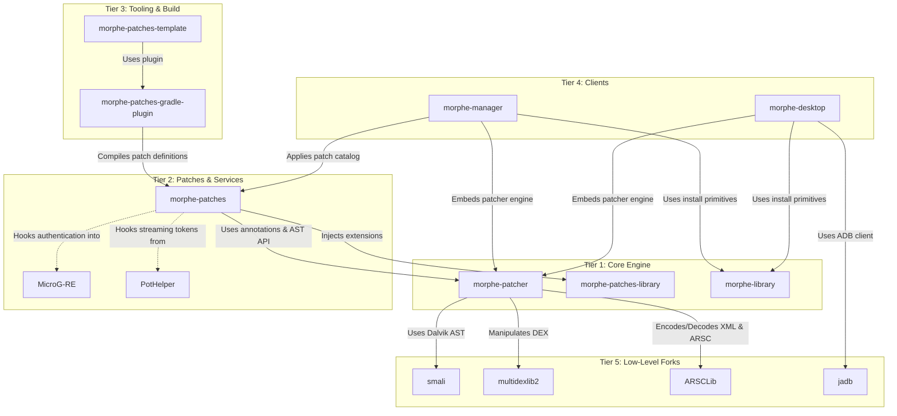

# Volume I: Chapter 2 — The 5-Tier Ecosystem Taxonomy

The Morphe project consists of 21 GitHub repositories maintained under the [`MorpheApp`](https://github.com/MorpheApp) organization. To understand how they interact, they are systematically classified into a **5-Tier Architecture Matrix**:

---

## 🏛️ Comprehensive Repository Matrix

| Tier | Repository | Language | Nature | Key Purpose & Role |
| :--- | :--- | :--- | :--- | :--- |
| **Tier 1: Core Engine** | [`morphe-patcher`](https://github.com/MorpheApp/morphe-patcher) | Kotlin | Core Engine | Disassembles DEX/resources, runs AST fingerprints, applies bytecode mutations, repacks APK. |
| **Tier 1: Core Engine** | [`morphe-patches-library`](https://github.com/MorpheApp/morphe-patches-library) | Java / Kotlin | Runtime Core | Shared runtime library injected into patched apps (`ByteTrieSearch`, `ResourceUtils`, `Logger`). |
| **Tier 1: Core Engine** | [`morphe-library`](https://github.com/MorpheApp/morphe-library) | Kotlin Multiplatform | Shared Library | Cross-platform installation primitives (Root `libsu`, Shizuku IPC, ADB execution). |
| **Tier 2: Patches & Services** | [`morphe-patches`](https://github.com/MorpheApp/morphe-patches) | Kotlin / Java | Primary Catalog | 860+ production patches for YouTube, Music, Reddit, and universal Android modifications. |
| **Tier 2: Patches & Services** | [`MicroG-RE`](https://github.com/MorpheApp/MicroG-RE) | Java | Fork (microg) | Standalone Google Play Services (GmsCore) spoofing identity provider for non-root patched apps. |
| **Tier 2: Patches & Services** | [`PotHelper`](https://github.com/MorpheApp/PotHelper) | Java | Microservice / Library | Mints YouTube PoTokens (Proof of Origin) via Play Integrity / Botguard challenge solver. |
| **Tier 3: Tooling & Build** | [`morphe-patches-gradle-plugin`](https://github.com/MorpheApp/morphe-patches-gradle-plugin) | Kotlin | Gradle Plugin | Compiles patch extensions to `.mpe` DEX and bundles patch definitions into `.mpp` JARs. |
| **Tier 3: Tooling & Build** | [`morphe-patches-template`](https://github.com/MorpheApp/morphe-patches-template) | Kotlin | Project Scaffold | Official GitHub template for developers to create custom third-party patch repositories. |
| **Tier 3: Tooling & Build** | [`changelog`](https://github.com/MorpheApp/changelog) | JavaScript | Fork | Semantic-release plugin generating conventional changelogs for automated patch release notes. |
| **Tier 3: Tooling & Build** | [`.github`](https://github.com/MorpheApp/.github) | Markdown / YAML | Meta | Organization profile, issue templates, and shared GitHub Actions CI/CD workflows. |
| **Tier 4: Client Applications** | [`morphe-manager`](https://github.com/MorpheApp/morphe-manager) | Kotlin / Compose | Android App | Flagship Android on-device patcher app with Material 3 Expressive UI and Shizuku support. |
| **Tier 4: Client Applications** | [`morphe-desktop`](https://github.com/MorpheApp/morphe-desktop) | Kotlin / Compose | Desktop App & CLI | Cross-platform desktop patcher (GUI & CLI) for Windows, macOS, and Linux with ADB bridge. |
| **Tier 4: Client Applications** | [`morphe-website`](https://github.com/MorpheApp/morphe-website) | JavaScript | Web App | Official web portal (https://morphe.software) for downloading Manager, docs, and news. |
| **Tier 4: Client Applications** | [`morphe-documentation`](https://github.com/MorpheApp/morphe-documentation) | Markdown | Docs | Community troubleshooting FAQs, patch manuals, and setup instructions. |
| **Tier 4: Client Applications** | [`morphe-branding`](https://github.com/MorpheApp/morphe-branding) | Assets / SVG | Branding | Official vector logos, wordmarks, color schemes, and iconography assets. |
| **Tier 5: Low-Level Forks** | [`smali`](https://github.com/MorpheApp/smali) | Java | Fork (iBotPeaches) | Assembler and disassembler for Android's Dalvik/ART bytecode (.dex format). |
| **Tier 5: Low-Level Forks** | [`multidexlib2`](https://github.com/MorpheApp/multidexlib2) | Java | Core Bytecode Lib | High-performance dex reading and writing library, parsing instruction opcodes and registers. |
| **Tier 5: Low-Level Forks** | [`ARSCLib`](https://github.com/MorpheApp/ARSCLib) | Java | Fork (REAndroid) | High-speed binary XML and `resources.arsc` table decoder and encoder. |
| **Tier 5: Low-Level Forks** | [`Apktool`](https://github.com/MorpheApp/Apktool) | Java | Fork (iBotPeaches) | Reverse engineering tool for unpacking APK resources, layouts, manifests, and assets. |
| **Tier 5: Low-Level Forks** | [`jadb`](https://github.com/MorpheApp/jadb) | Java | Utility Library | Pure Java implementation of the Android Debug Bridge (ADB) protocol client. |
| **Tier 5: Low-Level Forks** | [`ejs`](https://github.com/MorpheApp/ejs) | TypeScript | Fork (yt-dlp) | Embedded JavaScript runtime engine supporting media extractor logic. |
| **Tier 5: Low-Level Forks** | [`nowinandroid`](https://github.com/MorpheApp/nowinandroid) | Kotlin / Compose | Fork (Google) | Reference modular architecture fork used for testing modern Compose and Gradle conventions. |

---

## 🔄 Inter-Tier Dependency Graph

---

## 🎯 Architectural Synergies

1. **Compilation vs. Runtime Separation:**
   - At compile time, `morphe-patches-gradle-plugin` compiles bytecode extensions in `morphe-patches` into standalone Dalvik Executable chunks (`.mpe`).
   - At runtime, `morphe-patcher` merges these precompiled DEX instructions directly into the target APK without needing a full Java compiler on the Android device.

2. **Privilege Decoupling:**
   - Root users can use `morphe-library`'s `LocalRootInstaller` to perform direct `/data/app` mounting.
   - Non-root users install normally using Android's system `PackageInstaller` session or `Shizuku`, relying on `MicroG-RE` for Google authentication and signature spoofing.
