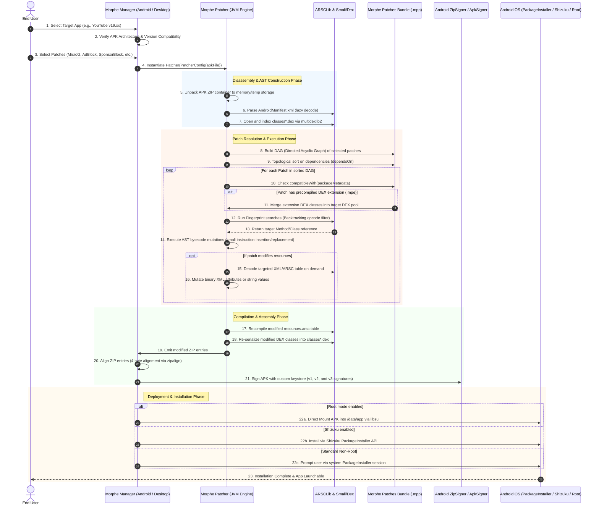

# Volume I: Chapter 3 — End-to-End Patching Pipeline

The Morphe patching pipeline is the orchestrated sequence of operations that transforms an unmodified stock Android APK into a fully patched, feature-enhanced, and signed APK.

---

## 🔁 Complete Lifecycle Sequence Diagram

---

## 🔍 Detailed Phase Breakdown

### Phase 1: Ingestion & Verification
1. **APK Extraction:** The user selects either an APK file downloaded from an APK mirror or the currently installed base APK extracted from `/data/app/*`.
2. **Compatibility Evaluation:** The `PackageMetadata` extractor reads `packageName`, `versionCode`, and `versionName` directly from the APK's binary manifest. It evaluates these values against the patch's declared `Compatibility` rules.

### Phase 2: In-Memory Indexing & Lazy Resource Decoding
1. In Morphe Patcher 2.0, resources are **not eagerly decoded**. Prior engines extracted every PNG, layout, and string pool, consuming hundreds of megabytes of RAM.
2. Only `AndroidManifest.xml` is decoded during initialization to obtain package identifiers and component declarations.
3. All DEX files (`classes.dex`, `classes2.dex`, `...`, `classesN.dex`) are indexed using `multidexlib2` into mutable class definition wrappers (`MutableClassDef`).

### Phase 3: DAG Dependency Resolution
1. Patches declare dependencies via `dependsOn(otherPatch)`.
2. A Directed Acyclic Graph (DAG) is constructed.
3. The engine performs a **topological sort** (Kahn's algorithm / DFS post-order). If cycles are detected, patching is aborted immediately with an explanatory error.

### Phase 4: Fingerprint Matching & AST Bytecode Mutation
1. For each patch, the engine evaluates its `MethodFingerprint` or `ClassFingerprint`.
2. Rather than hardcoded offsets, fingerprints match:
   - Specific opcode sequences (e.g., `sget-object`, `check-cast`, `invoke-virtual`).
   - String literals (e.g., `"player_response"`, `"ad_break"`).
   - Parameter and return type signatures.
3. **Backtracking Filter Matching:** If instruction 3 of a 5-instruction filter fails, Morphe backtracks to find the next valid instance of instruction 1 and retries.
4. Once located, bytecode mutations are applied:
   - Hook injection: Inserting `invoke-static {p0}, Lapp/morphe/extension/...;->hookMethod(...)V`.
   - Register manipulation: Replacing registers or branching instructions (`goto`, `return-void`).

### Phase 5: Merging Patch Extensions (`.mpe`)
1. Patches often need rich custom Java/Kotlin logic (such as an embedded HTTP client for SponsorBlock, or a custom UI dialog for settings).
2. Writing this in raw smali assembly would be error-prone and unmaintainable.
3. Instead, extensions are written in pure Java/Kotlin, compiled by Gradle into standalone DEX bytecode (`.mpe`), and merged directly into the target APK's DEX pool by Morphe Patcher.

### Phase 6: Binary Resource & ARSC Table Encoding
1. Modifications to string resources, themes, colors, and layout XML files are written back to `resources.arsc` using `ARSCLib`.
2. ARSCLib avoids full recompilation by directly modifying binary chunk tables, string pools, and entry maps.

### Phase 7: ZipAligning, Signing & Delivery
1. The modified DEX and ARSC files are repacked into a zip archive.
2. **4-Byte Alignment (ZipAlign):** Uncompressed data is 4-byte aligned to allow `mmap` optimization by Android's ART runtime.
3. **Cryptographic Signing:** The APK is signed with a generated custom keystore using Android's APK Signature Scheme v2/v3.
4. **Installation:** Delivered to the OS via Android's `PackageInstaller.Session`, Shizuku IPC, or root bind-mount.
