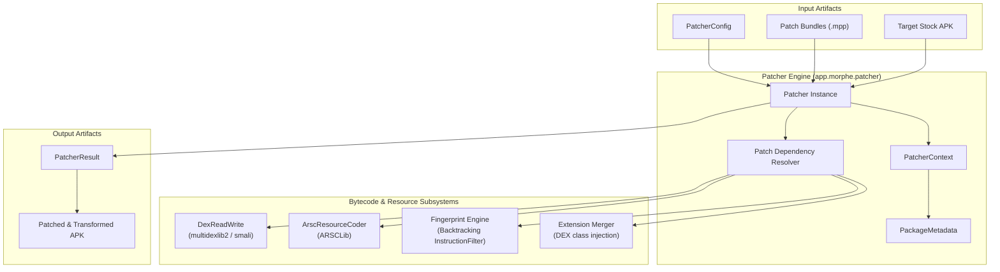

# Volume II: Chapter 1 — Morphe Patcher Internals

## 1. Engine Architecture & Core Design

The **Morphe Patcher** ([`morphe-patcher`](https://github.com/MorpheApp/morphe-patcher)) is the central bytecode manipulation and APK transformation engine of the entire Morphe ecosystem. It operates at the intersection of Dalvik/ART bytecode, binary Android resources, and dependency-graph execution.



---

## 2. Patcher Configuration: `PatcherConfig`

`PatcherConfig` defines execution boundaries, memory usage, verification modes, and backward-compatibility rules:

```kotlin
data class PatcherConfig(
    val apkFile: File,
    val temporaryFilesPath: File? = null,
    val verifier: DexVerifier = NoOpDexVerifier,
    val fileWorkspacePath: File? = null,
    val targetPatcherVersion: PatcherVersion? = null,
    val bytecodeMode: BytecodeMode = BytecodeMode.AUTO,
    val resourceMode: ResourceMode = ResourceMode.LAZY,
    val cpuArchitecture: CpuArchitecture? = null
)
```

### Key Parameters:
- `apkFile`: The source APK being transformed.
- `targetPatcherVersion`: Decides whether to enforce 2.0+ behaviors (such as exact string comparisons and lazy resource decoding) or preserve legacy bundle compatibility.
- `verifier`: Enforces Dalvik bytecode validation (`DexVerifier`) to guarantee that injected opcodes do not violate register constraints or type safety before APK repacking.
- `resourceMode`: Determines whether XML and binary tables are decoded lazily (`ResourceMode.LAZY`) or eagerly.

---

## 3. The Lazy Resource Decoding Revolution

In earlier versions (and ReVanced 1.x), the patcher unpacked and decoded all XML files and the entire `resources.arsc` string/table pool upfront. On memory-constrained devices (devices with 3GB - 4GB RAM), this caused fatal `OutOfMemoryError` failures.

Morphe Patcher 2.0 introduced **on-demand resource decoding**:
1. **Initial Phase:** Only `AndroidManifest.xml` is decoded during startup to extract `PackageMetadata`.
2. **On-Demand Phase:** Layouts, drawables, and string pools are only decoded when a patch explicitly invokes `get()`, `document()`, or `decode()`:
   ```kotlin
   // Lazy decoding syntax in Morphe 2.0
   decode("res/values*/strings.xml").forEach { path ->
       document(path).use { xmlDocument ->
           // Mutate XML nodes
       }
   }
   ```
3. **Decodable Querying:** Patches can inspect the presence of resource files without decoding them via `listDecodableFiles()`.

---

## 4. The Backtracking Fingerprint Matching Engine

Obfuscated Android applications rename classes, methods, and fields every release (e.g. `com.google.android.apps.youtube.app.WatchWhileActivity` becomes `ab.c1`). To locate code reliably, Morphe uses **Fingerprints**.

### The Anatomy of a `Fingerprint`
A fingerprint queries classes and methods using:
- **Opcode sequence filters** (`InstructionFilter`).
- **String constants** with exact or prefix matching (`StringComparisonType.EQUALS`, `STARTS_WITH`, `CONTAINS`).
- **Method parameter counts and return types**.
- **Access flags** (`AccessFlags.PUBLIC`, `STATIC`, etc.).

### Backtracking Filter Algorithm
A major limitation of previous engines was that if a multi-step instruction pattern matched step 1 and 2, but failed at step 3, the entire method search failed.

Morphe Patcher implements **full multi-instruction backtracking**:
- If instruction filter $N$ cannot match at the current position, the engine backtracks to filter $N-1$, finds the next occurrence of that instruction, and resumes matching forward.
- Retries work symmetrically across `MatchAfterImmediately`, `MatchAfterWithin(n)`, `MatchAfterLast()`, and `MatchBeforeFirst()`.

```kotlin
// Example Morphe Fingerprint
val playerInitFingerprint = MethodFingerprint(
    returnType = "V",
    accessFlags = listOf(AccessFlags.PUBLIC, AccessFlags.FINAL),
    parameters = listOf("Landroid/content/Context;", "Ljava/lang/String;"),
    strings = listOf(
        string("player_surface_created", StringComparisonType.EQUALS),
        string("playback_controller", StringComparisonType.STARTS_WITH)
    ),
    instructions = listOf(
        sgetObject(Opcode.SGET_OBJECT),
        invokeVirtual(Opcode.INVOKE_VIRTUAL),
        checkCast(Opcode.CHECK_CAST)
    )
)
```

---

## 5. In-Memory AST Mutation & Mutable Types

Morphe wraps Smali/Dexlib2 classes in mutable proxy objects:
- `MutableClass`
- `MutableMethod`
- `MutableField`

These mutable wrappers allow patches to edit instructions like an array:
```kotlin
method.apply {
    val index = instructions.indexOf(targetInstruction)
    
    // Replace instruction
    instructions[index] = BuilderInstruction21c(Opcode.CONST_STRING, targetRegister, StringReference("spoofed_val"))
    
    // Insert new instruction
    instructions.add(index + 1, BuilderInstruction10x(Opcode.RETURN_VOID))
}
```

When patching completes, `DexReadWrite` walks the modified `MutableClass` structures, optimizes register allocations, and serializes clean `classes*.dex` streams back into the APK container.
