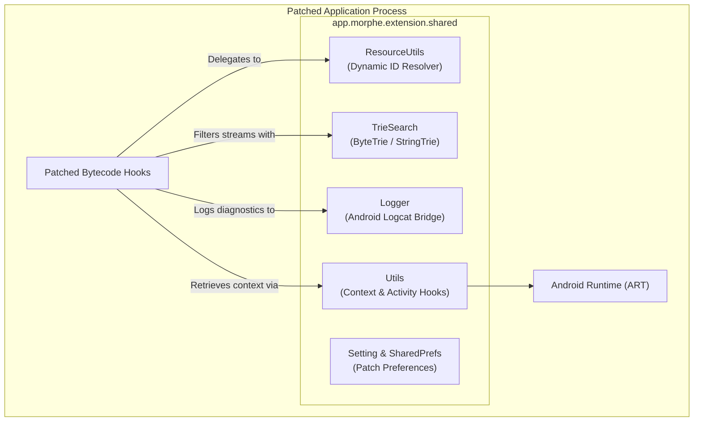

# Volume II: Chapter 2 — Morphe Patches Library

## 1. Overview & Architectural Role

The **Morphe Patches Library** ([`morphe-patches-library`](https://github.com/MorpheApp/morphe-patches-library)) provides the runtime support foundation that is compiled into `.mpe` patch extensions and injected directly into target Android applications.

While `morphe-patcher` operates outside the target app during the compilation phase, `morphe-patches-library` runs **inside the patched app process** at runtime. It solves fundamental Android modding challenges:
1. **Dynamic Resource Resolution Without `R.id`:** Injected code cannot rely on compiled `R.java` integers because resource IDs shift across app versions.
2. **High-Performance Stream Filtering:** Real-time ad and telemetry stripping requires sub-millisecond pattern matching on raw HTTP/Protobuf byte streams.
3. **Application Lifecycle Hooks & Context Acquisition:** Finding a valid `Context` or foreground `Activity` from hooked static methods.



---

## 2. Ultra-Fast Stream Filtering: `ByteTrieSearch` & `StringTrieSearch`

Modern Android clients (especially YouTube Innertube) stream media responses as serialized binary Protocol Buffers (`protobuf`). De-serializing hundreds of kilobytes of protobuf on every frame to identify sponsored cards or ad tracking pixels would degrade video playback frame rates.

`ByteTrieSearch` implements an $O(m)$ prefix search over raw `byte[]` arrays, avoiding object allocations:

```java
// Fast byte stream filtering example
ByteTrieSearch trie = new ByteTrieSearch();
trie.addPatterns(ByteTrieSearch.convertStringsToBytes(
    "ad_break_params",
    "compact_promoted_item_renderer",
    "video_ad_renderer"
));

// Evaluates in real-time during network stream read
boolean hasAdMarker = trie.search(streamByteBuffer);
if (hasAdMarker) {
    // Drop or sanitize chunk
}
```

### Algorithmic Properties:
- **Zero Allocation in Critical Path:** Operates directly over byte slices without instantiating intermediate `java.lang.String` objects.
- **Prefix Tree Traversal:** Processes incoming stream buffers in a single pass ($O(L)$ where $L$ is stream length).

---

## 3. Dynamic Resource Resolution: `ResourceUtils`

When a patch injects a custom settings screen or custom icon into an app, it needs resource IDs (e.g. `R.string.morphe_settings_title` or `R.drawable.ic_morphe_logo`).

Because compiled Android APKs dynamically assign IDs (e.g., `0x7f0b0021`), hardcoding integers causes instant `Resources.NotFoundException` when the app is updated.

`ResourceUtils` bridges this gap:
```java
public class ResourceUtils {
    public static int getIdentifier(@Nullable ResourceType type, String name) {
        Context context = getActivityOrContext();
        String packageName = context.getPackageName();
        return context.getResources().getIdentifier(name, type != null ? type.name() : null, packageName);
    }
}
```

### Fallback & Caching:
- It uses internal hash maps to cache mapped IDs, eliminating repeated expensive JNI calls into `AssetManager`.
- It dynamically falls back from `Activity` context to `Application` context if the foreground activity is paused or destroying.

---

## 4. Context & Activity Hooking: `Utils`

Many hooked Dalvik methods are static or lack a `Context` argument (e.g., lower-level network interceptors or video decoding callbacks).

`Utils.java` maintains a lifecycle-aware weak reference to the running application:
- Registers an `ActivityLifecycleCallbacks` listener upon initialization.
- Exposes `Utils.getContext()` and `Utils.getActivity()`.
- Guarantees thread-safe access to application resources and SharedPreferences across background coroutines and render threads.
