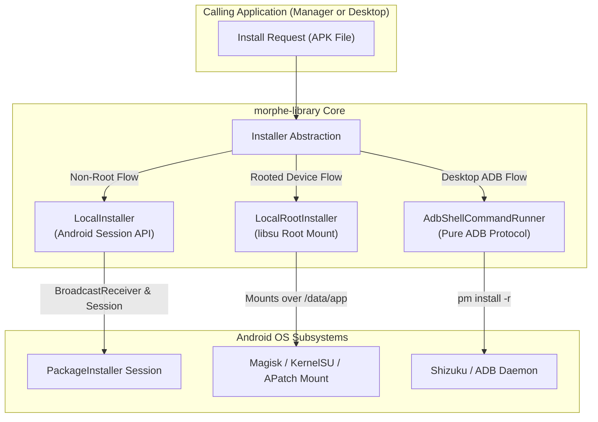

# Volume II: Chapter 3 — Morphe Library (Install Engine)

## 1. Overview & Architectural Role

The **Morphe Library** ([`morphe-library`](https://github.com/MorpheApp/morphe-library)) is a Kotlin Multiplatform (KMP) library engineered to solve one of the most complex challenges in Android modding: **deploying and installing the modified APK across divergent permission environments**.

Modern Android imposes strict signature and installation restrictions:
- Installing an APK with a mismatched signature over an existing stock app normally triggers `INSTALL_FAILED_UPDATE_INCOMPATIBLE`.
- Stock apps cannot be uninstalled if they are system-bundled without root.
- Background installations without prompting the user require either Root, Shizuku, or Device Owner privileges.

`morphe-library` provides unified, reactive abstractions that encapsulate these installation paths for both `morphe-manager` (Android) and `morphe-desktop` (via ADB).



---

## 2. Non-Root Installation: `LocalInstaller`

For non-root users, `LocalInstaller` leverages Android's native `android.content.pm.PackageInstaller` session API.

### Lifecycle of a Non-Root Install Session:
1. **Session Creation:** Calls `packageInstaller.createSession(SessionParams(MODE_FULL_INSTALL))`.
2. **Streaming Bytes:** Opens an output stream to the session and streams the patched APK bytes in chunks:
   ```kotlin
   session.openWrite("package", 0, apk.length()).use { outputStream ->
       apk.inputStream().copyTo(outputStream)
       session.fsync(outputStream)
   }
   ```
3. **Intent Commitment:** Commits the session using an `IntentSender` directed at an internal `BroadcastReceiver` (`LocalInstallerService`).
4. **Result Handling:** Receives `PackageInstaller.STATUS_PENDING_USER_ACTION` to prompt the system installation dialog, or returns `STATUS_SUCCESS` when complete.

---

## 3. Root Installation via Bind Mount: `LocalRootInstaller`

On rooted devices (Magisk, KernelSU, or APatch), users do not want to change the package signature or uninstall the original app, because they want to retain Google Play Services integration and system deep links.

`LocalRootInstaller` solves this through **Root Bind Mounting**:
1. **Root IPC Connection:** Connects to a `RootService` via John Wu's `libsu` IPC mechanism (`com.topjohnwu.superuser.ipc.RootService`).
2. **Mounting Over Original APK:** Rather than replacing the APK in `/data/app`, it mounts the patched APK file directly over the stock APK's path in the file system:
   ```shell
   mount -o bind /data/local/tmp/morphe_patched.apk /data/app/~~.../base.apk
   ```
3. **ART Optimization Refresh:** Forces Android's runtime compiler (`dex2oat`) to invalidate its cached compilation profile:
   ```shell
   pm compile -m speed -f com.google.android.youtube
   ```
4. **Zero Signature Conflict:** Because the underlying package was never replaced through the Package Manager, the system retains the original signature in `/data/system/packages.xml`, preventing any signature collision errors!

---

## 4. Desktop & Wireless ADB: `AdbShellCommandRunner`

When patching on a PC via `morphe-desktop`, the tool cannot invoke Android's `PackageInstaller` directly.

`AdbShellCommandRunner` implements a cross-platform command runner that speaks directly to the connected device:
- Detects USB and Wi-Fi ADB devices using `jadb`.
- Executes streaming split APK installs (`pm install-create`, `pm install-write`, `pm install-commit`).
- Handles SElinux permissions and automatically detects Android architecture (`arm64-v8a`, `armeabi-v7a`, `x86_64`).
