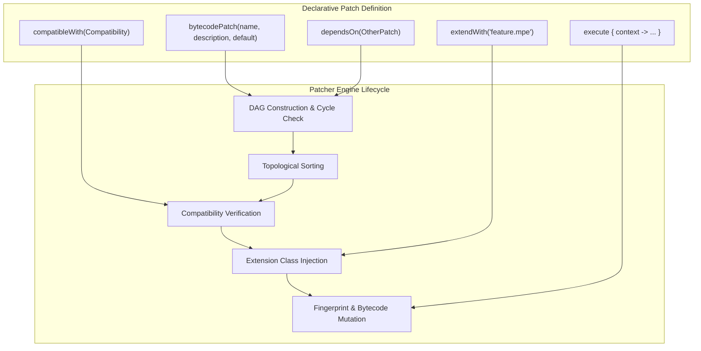

# Volume II: Chapter 4 — Patch Execution & Dependency Model

## 1. The Patch DSL Architecture

Patches in Morphe are declarative Kotlin objects built using a type-safe Domain Specific Language (DSL). The DSL abstracts away the raw complexities of DEX parsing, resource decoding, and file I/O, allowing developers to focus on reverse-engineered business logic.



---

## 2. Anatomy of a Bytecode Patch

Every bytecode patch defines metadata, target package compatibility, dependencies, and an execution lambda:

```kotlin
val disableShortsPatch = bytecodePatch(
    name = "Hide Shorts",
    description = "Removes YouTube Shorts buttons, shelf renderers, and pivot items.",
    default = true
) {
    // 1. Compatibility constraint
    compatibleWith(
        Compatibility(
            name = "YouTube",
            packageName = "com.google.android.youtube",
            targets = listOf(
                AppTarget(version = "19.16.39"),
                AppTarget(version = "19.20.34")
            )
        )
    )

    // 2. Upstream patch dependencies
    dependsOn(integrationsPatch)
    dependsOn(settingsPatch)

    // 3. Injected precompiled DEX extension
    extendWith("hide-shorts.mpe")

    // 4. Execution logic
    execute {
        // Fingerprint resolution
        val pivotBarClass = pivotBarFingerprint.result?.classDef
            ?: throw PatchException("Failed to locate PivotBar class")

        val mutableClass = mutableClassDefBy(pivotBarClass)
        
        // Mutate method bytecode
        mutableClass.methods.first { it.name == "createShortsTab" }.apply {
            instructions.clear()
            instructions.add(BuilderInstruction10x(Opcode.RETURN_VOID))
        }
    }
}
```

---

## 3. Directed Acyclic Graph (DAG) & Dependency Scheduling

When a user selects 40 patches out of 800 available patches in `morphe-manager`, they cannot be executed arbitrarily. Some patches depend on baseline hooks (e.g., `MicroG Support` depends on `GmsCore Support`, which depends on `Spoof Signature`).

### Topological Sorting Mechanics:
1. **Adjacency List Construction:** The engine builds a directed graph $G = (V, E)$ where vertices $V$ are patches, and directed edges $(u, v) \in E$ indicate that patch $u$ depends on patch $v$ (so $v$ must execute before $u$).
2. **Cycle Detection:** The engine performs a depth-first search (DFS) with three-color node coloring (`WHITE`, `GRAY`, `BLACK`). If a `GRAY` node is encountered, a circular dependency is reported and patching halts.
3. **Execution Order:** Once verified acyclic, a topological sort (reverse post-order traversal) produces the exact linear sequence of execution.

---

## 4. Precompiled DEX Extension Merging (`.mpe`)

A core strength of Morphe is the ability to write high-level Kotlin/Java extension classes (like HTTP callers, custom settings views, or caching layers) and merge them into the target APK.

### How `.mpe` Injection Works:
1. At build time, `morphe-patches-gradle-plugin` compiles Java/Kotlin code in `extensions/` into standard Dalvik bytecode `.dex` files, packaged as `.mpe` (Morphe Patch Extension).
2. During patch execution, `extendWith("xyz.mpe")` invokes `ClassMerger.merge()`.
3. The classes in `xyz.mpe` (e.g. `app.morphe.extension.youtube.ShortsFilter`) are merged directly into the target APK's `classes.dex` or an additional `classesN.dex`.
4. Then, the patch's bytecode instructions simply inject a static method invocation pointing to the newly merged class:
   ```smali
   invoke-static {p0}, Lapp/morphe/extension/youtube/ShortsFilter;->shouldHide(Landroid/view/View;)Z
   move-result v0
   if-eqz v0, :cond_skip
   ```

---

## 5. Patch Options & Configuration Schema

Patches can expose dynamic user options:
- Boolean toggles (e.g., "Enable Old Video Quality Menu").
- String inputs (e.g., custom API keys or custom user-agent headers).
- Choice dropdowns.

`morphe-patcher` provides an `options` DSL:
```kotlin
val customUserAgentOption = stringOption(
    key = "custom_user_agent",
    title = "Custom User Agent",
    description = "Override the default user agent sent to YouTube Innertube servers.",
    default = "Mozilla/5.0 (Linux; Android 14)..."
)

patchOptions {
    register(customUserAgentOption)
}
```

These options are exposed to `morphe-manager` and `morphe-desktop`, allowing users to customize patch parameters in the UI before clicking "Patch".
