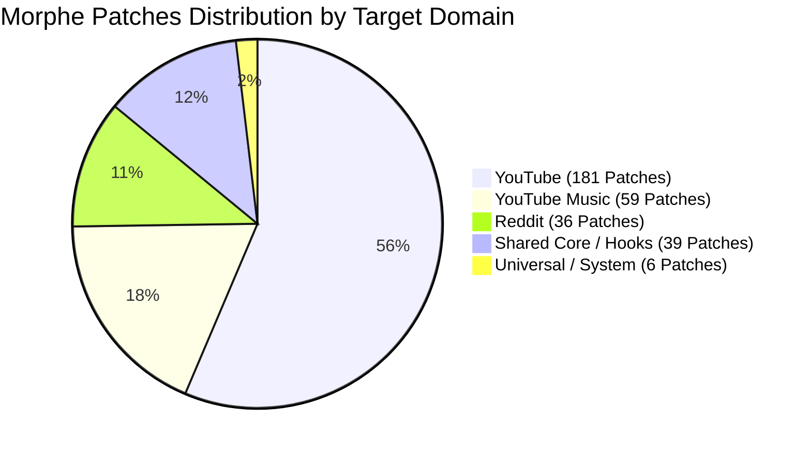
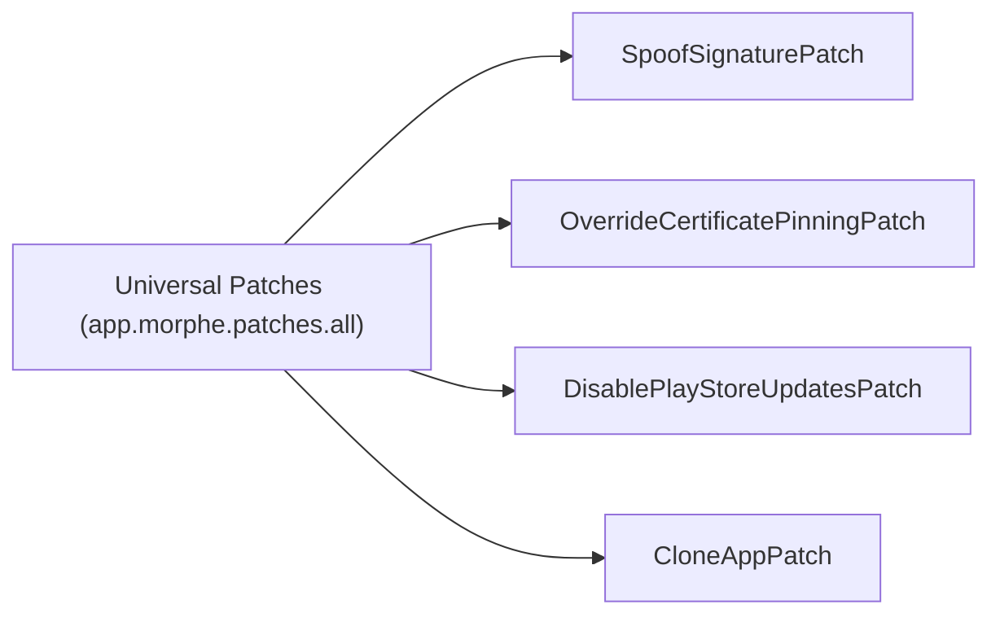

# Volume III: Chapter 1 — Morphe Patches Catalog Analysis

## 1. Catalog Architecture & Statistics

The **Morphe Patches** repository ([`morphe-patches`](https://github.com/MorpheApp/morphe-patches)) contains over 320 distinct patch definitions implemented in idiomatic Kotlin, spanning more than 860 source and extension files.

Each patch is modular, declarative, and operates independently or cooperatively through the DAG dependency model.

---

## 2. YouTube Patches Deep Dive (181 Patches)

YouTube is the most heavily modified application in the ecosystem due to its dense advertising layers, algorithmic clutter, and strict playback barriers.

### 2.1 Video & Feed Ad Blocking
- **`VideoAdsPatch`:** Hooks into Google's Ad Manager and Player Response deserializers. When Innertube returns `playerResponse.adPlacements`, the patch intercepts the stream and nullifies the ad placement array before the player state machine can queue video ads.
- **`GeneralAdsPatch`:** Targets `compactPromotedItemRenderer`, `bannerPromoRenderer`, and `statementBannerRenderer` in the home and search feeds, collapsing their layout heights to `0dp` and removing them from view recycling pools.

### 2.2 Background Playback & Codec Unlocking
- **`BackgroundPlaybackPatch`:** YouTube normally pauses audio playback when the activity transitions to `onPause()` or `onStop()` (unless YouTube Premium is detected). This patch hooks `PlaybackModality` and `BackgroundTransitionListener`, forcing the player service to ignore lifecycle pauses and continue decoding audio tracks.
- **`CodecSpoofPatch` / `AdvancedVideoQualityMenuPatch`:** Unlocks VP9 and AV1 codecs and restores the classic, granular video resolution selection menu (144p to 4K 60fps HDR) instead of Google's simplified "Auto / Higher Picture Quality / Data Saver" abstraction.

### 2.3 Interface Sanitation & Shorts Suppression
- **`HideShortsPatch`:** Intercepts `PivotBarRenderer` to excise the Shorts navigation tab, hides the Shorts carousel from the subscription and home feeds, and reroutes any direct Shorts URLs into the standard video player view.
- **`CustomPlayerOverlayPatch`:** Allows toggling overlay buttons, including quick speed toggles (0.25x to 3.0x), download buttons, loop toggles, and sleep timers.

---

## 3. YouTube Music Patches (59 Patches)

YouTube Music features distinct audio-first constraints and dedicated UI components:

| Patch Name | Bytecode Target | Practical User Impact |
| :--- | :--- | :--- |
| **`AudioAdsPatch`** | Audio stream interrupter callbacks | Suppresses intermittent interstitial audio ads without pausing music queues. |
| **`ExclusiveAudioQualityPatch`** | Audio track bitrate selector | Unlocks 256kbps AAC high-bitrate streaming without requiring a Music Premium subscription. |
| **`BackgroundAudioPatch`** | MediaSession lifecycle bridge | Permits continuous music playback when the screen is turned off or apps are switched. |
| **`LyricsParserPatch`** | Custom synced lyrics fetcher | Injects real-time synced lyrics from external providers (Kugou/Musixmatch) directly into the now-playing sheet. |
| **`AndroidAutoPatch`** | MediaBrowserService permission stub | Spoofs Android Auto vehicle certificates, allowing patched YouTube Music on in-car head units. |

---

## 4. Reddit Patches (36 Patches)

The official Reddit client features intrusive promoted posts and tracking mechanisms:

- **`HidePromotedPostsPatch`:** Scans Reddit's feed adapters for `Link` objects where `isPromoted == true` or `isAd == true`, pruning them prior to RecyclerView layout passes.
- **`SanitizeSharingLinksPatch`:** Strips tracking parameters (`?utm_source=share&utm_medium=android_app`) from copied post links, protecting user privacy when sharing content.
- **`OpenLinksInExternalBrowserPatch`:** Bypasses Reddit's embedded Chrome Custom Tabs webview, redirecting all outbound external links to the user's default system browser.
- **`CustomBrandingNamePatch` & `AppIconPatch`:** Replaces Reddit's dynamic launcher icon and app name with custom, stealth, or retro assets.

---

## 5. Universal Android Patches (All Apps)

These patches are platform-level transformations applicable to virtually any Android APK:

1. **`SpoofSignaturePatch`:** Intercepts `PackageManager.getPackageInfo()` calls within the app's process, returning the original developer certificate hash (e.g., Google LLC) even when signed with a custom test key.
2. **`OverrideCertificatePinningPatch`:** Hooks `TrustManagerImpl.checkTrustedRecursive()` and OkHttp's `CertificatePinner`, bypassing SSL/TLS certificate pinning for security auditing and debugging.
3. **`DisablePlayStoreUpdatesPatch`:** Sets the APK's `versionCode` in the binary `AndroidManifest.xml` to `Integer.MAX_VALUE` (2,147,483,647), preventing the Google Play Store from prompting to overwrite the patched app with an unpatched stock release.
4. **`CloneAppPatch`:** Changes the application package identifier (e.g. from `com.reddit.frontpage` to `com.reddit.morphe`), allowing the patched build to be installed side-by-side with the official app.
