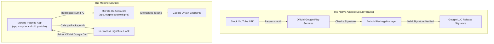

# Volume III: Chapter 2 — MicroG-RE & GMS Signature Spoofing

## 1. The Core Dilemma: Google Play Services Authentication

Stock Google applications (YouTube, YouTube Music) rely heavily on Google Play Services (`com.google.android.gms`, or GmsCore) for:
- User authentication via OAuth 2.0.
- Account token synchronization (subscriptions, watch history, liked videos).
- Cast v3 protocol negotiation (Chromecast).
- Push notifications via Firebase Cloud Messaging (FCM).



### The Unrooted Signature Barrier:
1. When an APK is patched and re-signed with a non-Google keystore, official `com.google.android.gms` rejects all authentication requests because the caller's signing certificate does not match Google's official certificate.
2. System `PackageManager` enforces this at the OS Binder IPC boundary.
3. On unrooted Android devices, third-party apps cannot modify `/system` or `/data/system/packages.xml` to grant OS-level signature spoofing permissions.

---

## 2. MicroG-RE: The Specialized GmsCore Fork

To solve this, Morphe maintains **MicroG-RE** ([`MicroG-RE`](https://github.com/MorpheApp/MicroG-RE)), a fork of the open-source `microg/GmsCore`.

### Architectural Modifications in MicroG-RE:
1. **Isolated Package Namespace:** Changed package name to `app.morphe.android.gms` so it can be installed alongside official Google Play Services without conflict.
2. **Permissive Signature Verification:** Strips client signature checks within the MicroG daemon, allowing apps signed by any key to request OAuth credentials and cast tokens.
3. **Optimized ABI Builds:** Builds stripped architecture-specific binaries (`arm64-v8a` and `armeabi-v7a`), cutting the APK payload size from 45MB down to less than 20MB.

---

## 3. The Bytecode Hook: `GmsCoreSupportPatch`

The client application (YouTube) still believes it is speaking to `com.google.android.gms`. The `GmsCoreSupportPatch` bridges this gap at the Dalvik bytecode level.

### Key Bytecode Transformations:
1. **Package Redirection:** Replaces string constants and URI authorities:
   - `"com.google.android.gms"` $\rightarrow$ `"app.morphe.android.gms"`
   - `"com.google.android.gsf"` $\rightarrow$ `"app.morphe.android.gsf"`
2. **Intent Filter & Action Rewriting:**
   - Auth intents (`com.google.android.gms.auth.service.START`) are retargeted to Morphe's MicroG auth service.
3. **In-Process Signature Spoofing:**
   Hooks the application's internal `PackageManager` calls:
   ```smali
   # Hooking getPackageInfo to return official Google signature bytes
   invoke-virtual {v0, v1, v2}, Landroid/content/pm/PackageManager;->getPackageInfo(Ljava/lang/String;I)Landroid/content/pm/PackageInfo;
   move-result-object v0
   invoke-static {v0}, Lapp/morphe/extension/shared/patches/GmsCoreSupportPatch;->spoofPackageInfo(Landroid/content/pm/PackageInfo;)Landroid/content/pm/PackageInfo;
   move-result-object v0
   ```

---

## 4. Cast Context & Media Route Provider Fixes

Google Cast v3 relies on Play Services' `CastMediaRouteProviderService`.

In stock YouTube, attempting to cast on a modified APK causes instant crashes due to strict cast authentication handshakes.

`GmsCoreSupportPatch` hooks `CastContextFetchFingerprint`:
- Stubs `CastContext.getSharedInstance()` to catch unhandled `GooglePlayServicesNotAvailableException`.
- Gracefully falls back to local media playback or standard DIAL (Discovery and Launch) protocols, preventing the UI from freezing when nearby casting devices are polled.
