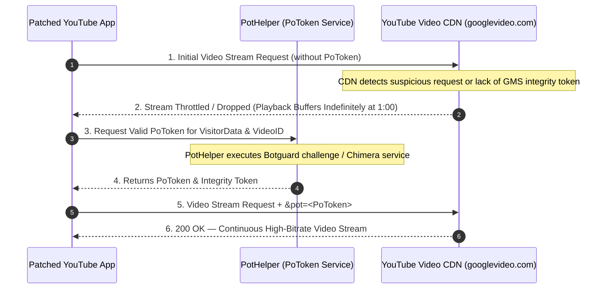
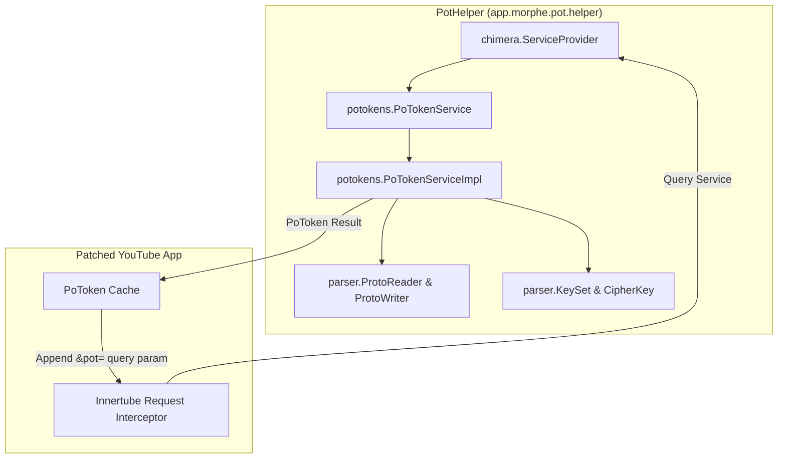

# Volume III: Chapter 3 — PoToken Mechanics & PotHelper

## 1. The Playback Buffering Crisis: Botguard & PoToken

In 2023–2024, Google deployed an aggressive anti-bot protection mechanism to YouTube known as **Proof of Origin Token (PoToken)**.

### Symptoms of the Unsolved Challenge:
- Unpatched clients or clients without valid PoTokens experience playback buffering after 30 to 90 seconds.
- Re-requesting the video stream returns HTTP 403 Forbidden.
- Web scrapers (yt-dlp, NewPipe, ReVanced) were disrupted until PoToken generation was reverse-engineered.

---

## 2. What is a PoToken?

A **PoToken** is a base64-encoded, cryptographically signed token generated by Google's proprietary **Botguard** VM or the Android Play Integrity Chimera service.

### Components of the Token:
1. **Visitor Data (`visitorData`):** A unique session identifier assigned by YouTube when the app connects to the API.
2. **Integrity Token:** A cryptographic blob attesting that the request originates from a valid Android device environment.
3. **Session Secret / Key:** Generated using AES/HMAC keys negotiated with Google's servers.

---

## 3. Architecture of PotHelper

To mint PoTokens reliably, Morphe created **PotHelper** ([`PotHelper`](https://github.com/MorpheApp/PotHelper)). It is an embedded Java service and standalone helper that emulates the internal GMS PoToken Chimera endpoint.

### Core Subsystems:
1. **`PoTokenService` & `PoTokenServiceImpl`:** Implements Google's internal `com.google.android.gms.potokens.PoToken` AIDL interface.
2. **`ProtoReader` & `ProtoWriter`:** Lightweight, zero-dependency Protocol Buffer serializer and deserializer built specifically to read and construct Google's internal token wire format without pulling in the massive Google protobuf runtime.
3. **`KeySet` & `CipherKey`:** Handles token decryption, symmetric key derivation, and timestamp validation.

---

## 4. Integration into Morphe Patches

Inside `morphe-patches`, the `ClientSpoofPatch` and `GmsCoreSupportPatch` hook the player's HTTP network interceptor:
1. Before YouTube dispatches a media request to `https://*.googlevideo.com/videoplayback`, the interceptor calls `PotHelper.getPoToken(context)`.
2. The generated token is appended as a query parameter:
   `&pot=<token_string>`
3. The video streaming server validates the cryptographic signature of the token and streams video segments uninterrupted at full bandwidth.
