# Volume III: Chapter 4 — SponsorBlock & Return YouTube Dislike Integrations

## 1. Crowdsourced Intelligence in Client Modding

Beyond native ad-blocking, Morphe integrates decentralized, community-driven APIs to enrich media consumption:
1. **SponsorBlock:** Community-submitted timestamps that automatically identify and skip sponsor segments, intro animations, end-cards, and self-promotions baked directly into video tracks.
2. **Return YouTube Dislike (RYD):** Reconstructs and displays video dislike counts removed by Google in 2021, using statistical extrapolation and crowdsourced extension telemetry.

```mermaid
graph TD
    subgraph UI["YouTube Player Interface"]
        V["ExoPlayer / Media Pipeline"]
        SB_BTN["SponsorBlock Skip Toast / Button"]
        RYD_LBL["Dislike Counter TextView"]
    end

    subgraph Hooks["Morphe Injected Extensions"]
        SB_H["SponsorBlockController"]
        RYD_H["ReturnYouTubeDislikeController"]
        CACHE["Disk / LRU Memory Cache"]
    end

    subgraph APIs["External Crowdsourced APIs"]
        SB_API["https://sponsor.ajay.app/api/skipSegments"]
        RYD_API["https://returnyoutubedislikeapi.com/votes"]
    end

    V -->|Reports current playback time ms| SB_H
    SB_H -->|Fetches videoId segments| SB_API
    SB_H --> CACHE
    SB_H -->|Seeks past sponsor interval| V
    SB_H -->|Triggers UI toast| SB_BTN

    V -->|New video loaded| RYD_H
    RYD_H -->|Fetches dislike count| RYD_API
    RYD_H --> CACHE
    RYD_H -->|Sets text on dislike element| RYD_LBL
```



---

## 2. SponsorBlock Implementation Mechanics

### Segment Classification & Actions
SponsorBlock segments fall into multiple categories configured via Morphe settings:
- `sponsor`: Paid promotional segments.
- `intro`: Title card or intermission animations.
- `outro`: End-of-video credits and cards.
- `interaction`: Reminders to like, comment, or subscribe.
- `selfpromo`: Merch plugs and personal channel announcements.
- `music_offtopic`: Non-music parts in music videos.

Each category can be set to:
1. **Automatic Skip:** Jumps the playback head seamlessly to the segment's end time.
2. **Manual Skip:** Displays an on-screen floating skip prompt.
3. **Show in Seekbar Only:** Renders colored segments on the scrubber bar without skipping.
4. **Disabled:** Completely ignores the category.

### Bytecode Hook Point
The patch hooks YouTube's `PlaybackController` or `ExoPlayer` time-update event loop (which fires every 100ms):
```java
public static void onTimeUpdate(long currentPositionMs) {
    for (Segment segment : activeSegments) {
        if (currentPositionMs >= segment.startMs && currentPositionMs < segment.endMs) {
            if (segment.behavior == Behavior.AUTO_SKIP) {
                playbackController.seekTo(segment.endMs);
                showSkipNotification(segment);
            }
        }
    }
}
```

---

## 3. Return YouTube Dislike (RYD) Integration

### The Metric Reconstruction Challenge
Since Google removed public dislike data from the YouTube API, the official client only receives the raw `likes` count.

The `ReturnYouTubeDislikePatch` performs two operations:
1. **API Ingestion:** Asynchronously calls `https://returnyoutubedislikeapi.com/votes?videoId={id}`.
2. **UI Injection:** Fingerprints YouTube's `LikeDislikeButtonRenderer` in the action bar below the video player.
3. **Layout Mutation:** Replaces the generic dislike thumb button icon with a composite widget displaying the formatted dislike number (e.g., `42K`).

### Network Resiliency & Zero UI Latency:
- All external API calls run on background coroutines (`Dispatchers.IO`).
- If an API is unreachable or rate-limited, the UI fails gracefully to stock behavior without blocking video playback or delaying UI rendering.
- An LRU cache holds up to 200 recent video metrics to prevent duplicate network requests when navigating back and forth.
