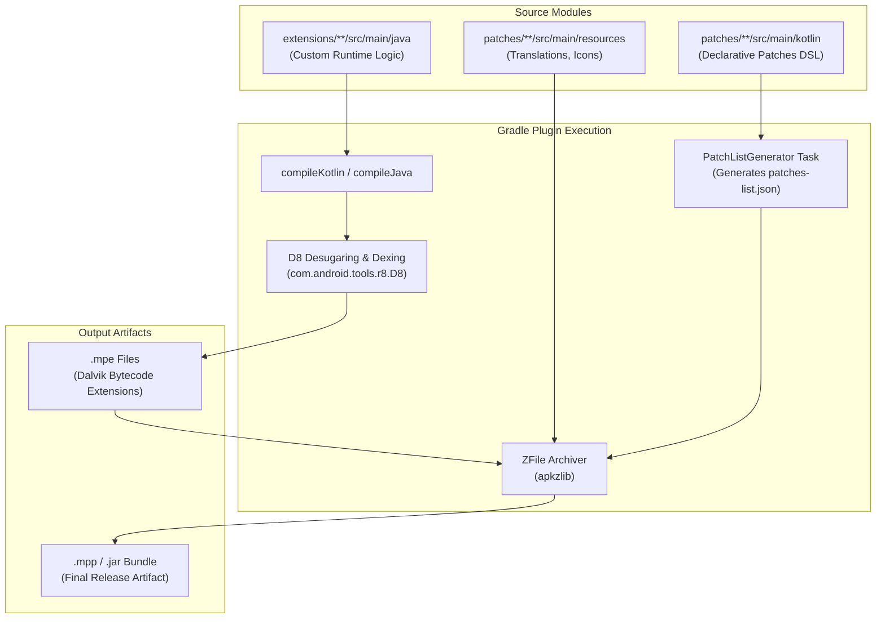

# Volume IV: Chapter 1 — Morphe Patches Gradle Plugin

## 1. The Build Orchestration Problem

Developing Android patches presents a compilation puzzle:
1. Patch logic is written in high-level Kotlin/Java with IDE autocompletion and type-safety.
2. The target environment (Android runtime) executes Dalvik Executable (`.dex`) instructions, not JVM `.class` bytecode.
3. The patches must bundle:
   - Declarative patch metadata (`patches-list.json`).
   - Precompiled Dalvik extensions (`.mpe` files).
   - Resources, drawables, and localized XML files.
   - Patcher version compatibility manifests.

The **Morphe Patches Gradle Plugin** ([`morphe-patches-gradle-plugin`](https://github.com/MorpheApp/morphe-patches-gradle-plugin)) automates this entire toolchain.



---

## 2. Core Plugin Components

The Gradle plugin exposes three specialized plugins:

### 1. `PatchesPlugin` (`app.morphe.patches`)
Applied to the primary patch project:
- Configures JVM target compatibility (`JavaVersion.VERSION_17` or `VERSION_21`).
- Runs **Google D8 compiler** via `D8Command` directly in Gradle to compile JVM `.class` binaries into Dalvik `.dex` format.
- Packages all output components into the `.mpp` container using `ZFile` from Android's `apkzlib`.
- Injects the `Patcher-Version: 2.x.x` attribute into `META-INF/MANIFEST.MF` to guarantee engine backward compatibility.

### 2. `ExtensionPlugin` (`app.morphe.patches.extension`)
Applied to individual extension subprojects in `extensions/`:
- Configures Android compilation flags.
- Links against `morphe-patches-library` for `ResourceUtils` and `ByteTrieSearch`.
- Outputs compiled `.mpe` assets consumed by the parent patch bundle.

### 3. `SettingsPlugin` (`app.morphe.patches.settings`)
Applied in `settings.gradle.kts`:
- Dynamically discovers all extension submodules in the `extensions/` directory without manual `include("...")` declarations.

---

## 3. Configuration DSL: `morphePatches`

In `build.gradle.kts`, developers configure bundle attributes:

```kotlin
plugins {
    id("app.morphe.patches")
}

morphePatches {
    // Unique bundle identifier
    name = "morphe-custom-patches"
    
    // Description exposed in Manager UI
    description = "Community enhancements and privacy patches"
    
    // Target patcher engine requirement
    patcherVersion = "2.0.1"
}
```

Running `./gradlew build` automatically compiles all Kotlin source files, desugars modern Java APIs with D8, generates `patches-list.json`, and outputs the release `.mpp` bundle into `build/libs/`.
