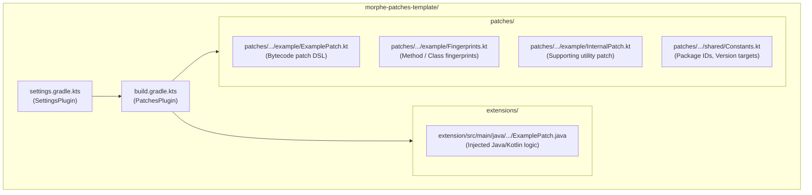

# Volume IV: Chapter 2 — Morphe Patches Template

## 1. Scaffold Architecture for Patch Developers

The **Morphe Patches Template** ([`morphe-patches-template`](https://github.com/MorpheApp/morphe-patches-template)) is the official boilerplate designed for developers wishing to author and release custom third-party patches compatible with `morphe-manager` and `morphe-desktop`.



---

## 2. Directory Layout & File Roles

```
morphe-patches-template/
├── .github/workflows/          # Automated GitHub Actions release pipeline
├── build.gradle.kts            # Root build script applying app.morphe.patches
├── settings.gradle.kts         # Root settings applying app.morphe.patches.settings
├── gradle/libs.versions.toml   # Dependency version catalog
│
├── extensions/
│   └── extension/
│       ├── build.gradle.kts    # Extension build configuration
│       └── src/main/java/app/template/extension/
│           └── ExamplePatch.java # High-level code to be merged into target APK
│
└── patches/
    ├── build.gradle.kts        # Patch bundle build configuration
    └── src/main/kotlin/app/template/patches/
        ├── example/
        │   ├── ExamplePatch.kt # Patch definition using bytecodePatch { ... }
        │   ├── Fingerprints.kt # Opcode patterns to locate obfuscated methods
        │   └── InternalPatch.kt# Helper patches
        └── shared/
            └── Constants.kt    # Compatibility and string constants
```

---

## 3. Dissecting the Template Example Patch

### 1. Injected Runtime Extension (`ExamplePatch.java`):
```java
package app.template.extension;

import android.util.Log;

public class ExamplePatch {
    public static void hookMethod() {
        Log.i("MorpheTemplate", "Injected bytecode executed successfully!");
    }
}
```

### 2. Method Fingerprint (`Fingerprints.kt`):
```kotlin
package app.template.patches.example

import app.morphe.patcher.MethodFingerprint
import com.android.tools.smali.dexlib2.Opcode

val exampleMethodFingerprint = MethodFingerprint(
    returnType = "V",
    strings = listOf("target_initialization_string"),
    instructions = listOf(
        invokeVirtual(Opcode.INVOKE_VIRTUAL),
        returnVoid(Opcode.RETURN_VOID)
    )
)
```

### 3. Patch Definition (`ExamplePatch.kt`):
```kotlin
package app.template.patches.example

import app.morphe.patcher.patch.bytecodePatch
import app.template.patches.shared.Constants.COMPATIBILITY_TARGET

val examplePatch = bytecodePatch(
    name = "Template Example Patch",
    description = "Demonstrates injecting an extension call into a fingerprinted method.",
    default = true
) {
    compatibleWith(COMPATIBILITY_TARGET)
    extendWith("extension.mpe")

    execute {
        val method = exampleMethodFingerprint.result?.mutableMethod
            ?: throw PatchException("Target method not found")

        // Inject hook at index 0
        method.instructions.add(
            0,
            BuilderInstruction35c(
                Opcode.INVOKE_STATIC,
                0, 0, 0, 0, 0, 0,
                MethodReference("Lapp/template/extension/ExamplePatch;", "hookMethod", emptyList(), "V")
            )
        )
    }
}
```

---

## 4. Consuming Custom Bundles in Morphe Manager

When compiled via CI, GitHub Actions outputs a `morphe-custom-patches-*.mpp` file and a `patches-list.json` metadata index.

Users can add this custom bundle directly into **Morphe Manager**:
1. Open **Morphe Manager** $\rightarrow$ **Settings** $\rightarrow$ **Sources**.
2. Select **Add Custom Patch Source**.
3. Provide the GitHub repository URL (`https://github.com/user/custom-patches`).
4. Morphe Manager automatically fetches the latest `.mpp` release and presents your new patches in the patch selection list!
