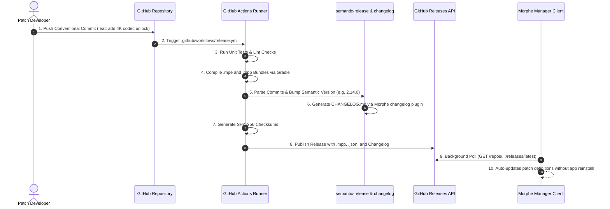

# Volume IV: Chapter 3 — CI/CD & Semantic Release Pipeline

## 1. Automated Continuous Delivery in Morphe

The Morphe ecosystem delivers patch updates rapidly—often releasing updates within hours of an upstream YouTube or Reddit app update.

To sustain this velocity without human bottlenecks, Morphe employs a fully automated **Continuous Delivery & Semantic Release Pipeline** orchestrated across [`.github`](https://github.com/MorpheApp/.github) and [`changelog`](https://github.com/MorpheApp/changelog).

---

## 2. Conventional Commits & Version Determination

Morphe strictly follows the [Conventional Commits](https://www.conventionalcommits.org/) specification:
- `fix(youtube): resolve playback buffering on v19.20`: Bumps patch version (`2.14.0` $\rightarrow$ `2.14.1`).
- `feat(music): add synced lyrics parser`: Bumps minor version (`2.14.0` $\rightarrow$ `2.15.0`).
- `feat(engine)!: migrate to lazy resource decoding`: Bumps major version (`2.0.0` $\rightarrow$ `3.0.0`).

---

## 3. The `changelog` Release Plugin

Morphe maintains [`MorpheApp/changelog`](https://github.com/MorpheApp/changelog), a specialized `semantic-release` plugin:
- Aggregates commit logs grouped by target application (`YouTube`, `Reddit`, `Music`, `Universal`).
- Formats Markdown release notes directly into `CHANGELOG.md`.
- Injects clickable GitHub issue and pull request cross-references.

---

## 4. Release Asset Integrity & Security

Every automated build produces cryptographic verification assets:
1. **`morphe-patches-*.mpp`:** The primary bundle container.
2. **`patches-list.json`:** Machine-readable catalog containing descriptions, options, and compatibility constraints consumed by Morphe Manager.
3. **`sha256sum.txt`:** SHA-256 hashes of all released binaries, preventing man-in-the-middle tampering during bundle downloads.

### Zero-Reinstall Updates:
Because `morphe-manager` downloads and parses `.mpp` files dynamically at runtime, **users never need to update the Manager APK to receive new patches**. As soon as a patch is released on GitHub, it appears in the Manager UI instantly.
