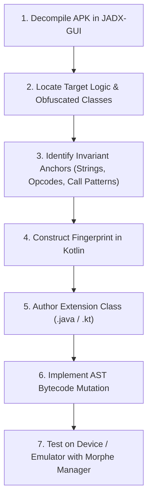

# Volume IV: Chapter 4 — The Definitive Patch Authoring Guide

## 1. The Patch Engineering Mindset

Writing a Morphe patch is not simply finding a line of code and replacing it. Because commercial Android apps release weekly updates with randomized obfuscation names, an effective patch author must think in **structural invariants**.



---

## 2. Step-by-Step Tutorial: Disabling a Feature Banner

Let's walk through an end-to-end example: removing an annoying "Upgrade to Premium" banner from an app.

### Step 1: APK Reconnaissance in JADX
1. Open the target APK in [JADX-GUI](https://github.com/skylot/jadx).
2. Search for unique layout resource names (e.g., `premium_upgrade_banner`).
3. Locate the Java class that references this resource ID:
   ```java
   // Decompiled obfuscated class in JADX (e.g., a.b.x1)
   public void a(Context context, View view) {
       if (this.b.isPremiumUser()) {
           view.setVisibility(8); // GONE
       } else {
           Log.d("BannerController", "Showing premium upgrade prompt");
           view.setVisibility(0); // VISIBLE
       }
   }
   ```

### Step 2: Extracting Invariant Anchors
Notice what changes and what stays invariant:
- **Variant:** Class name `a.b.x1` and field `this.b` will change on the next app update.
- **Invariant:**
  - String constant: `"Showing premium upgrade prompt"`.
  - Method parameters: `(Landroid/content/Context;Landroid/view/View;)`.
  - Opcode pattern: `INVOKE_VIRTUAL` followed by `CONST_8` and `INVOKE_VIRTUAL` (`setVisibility`).

### Step 3: Writing the Method Fingerprint
In `patches/.../Fingerprints.kt`:
```kotlin
val premiumBannerFingerprint = MethodFingerprint(
    returnType = "V",
    parameters = listOf("Landroid/content/Context;", "Landroid/view/View;"),
    strings = listOf(
        string("Showing premium upgrade prompt", StringComparisonType.EQUALS)
    ),
    instructions = listOf(
        invokeVirtual(Opcode.INVOKE_VIRTUAL),
        const4(Opcode.CONST_4), // loads visibility int
        invokeVirtual(Opcode.INVOKE_VIRTUAL) // calls setVisibility
    )
)
```

### Step 4: Authoring the Injected Extension
In `extensions/banner/src/main/java/app/morphe/extension/banner/BannerHook.java`:
```java
package app.morphe.extension.banner;

import android.view.View;

public class BannerHook {
    public static void forceHideBanner(View view) {
        if (view != null) {
            view.setVisibility(View.GONE);
        }
    }
}
```

### Step 5: Assembling the Bytecode Patch
In `patches/.../HideBannerPatch.kt`:
```kotlin
val hideBannerPatch = bytecodePatch(
    name = "Hide Premium Banner",
    description = "Forces the premium banner to remain permanently hidden.",
    default = true
) {
    compatibleWith(COMPATIBILITY_TARGET)
    extendWith("banner.mpe")

    execute {
        val method = premiumBannerFingerprint.result?.mutableMethod
            ?: throw PatchException("Failed to fingerprint premium banner method")

        // Locate the setVisibility call index
        val targetIndex = method.instructions.indexOfFirst {
            it.opcode == Opcode.INVOKE_VIRTUAL &&
            (it as? ReferenceInstruction)?.reference?.toString()?.contains("setVisibility") == true
        }

        if (targetIndex != -1) {
            // Inject call to our forceHideBanner method right before it displays
            method.instructions.add(
                targetIndex,
                BuilderInstruction35c(
                    Opcode.INVOKE_STATIC,
                    1, 1, 0, 0, 0, 0, // passes register containing View (p1)
                    MethodReference("Lapp/morphe/extension/banner/BannerHook;", "forceHideBanner", listOf("Landroid/view/View;"), "V")
                )
            )
        }
    }
}
```

---

## 3. Best Practices & Pitfalls to Avoid

> [!IMPORTANT]
> **Register Discipline:** Always inspect `method.registerCount` before introducing new registers. If you need scratch registers, either reuse existing dead registers or increase `.registers` / `.locals` count in the Smali method header.

> [!WARNING]
> **Avoid Fragile Fingerprints:** Never rely solely on instruction opcodes without at least one unique string literal or specific type signature. Blind opcode matching frequently hooks unintended methods in large codebases.

> [!TIP]
> **Test Across Multiple Versions:** Always verify that your fingerprint resolves successfully on at least 3 consecutive minor versions of the target application.
