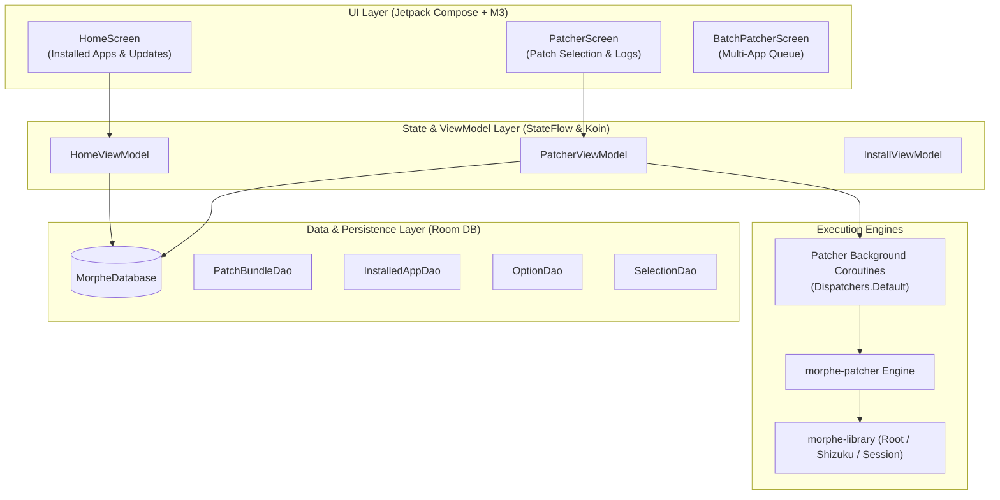

# Volume V: Chapter 1 — Morphe Manager (Android App)

## 1. Architectural Philosophy & Overview

**Morphe Manager** ([`morphe-manager`](https://github.com/MorpheApp/morphe-manager)) is the flagship Android client for the Morphe ecosystem. Built entirely from scratch with **Kotlin and Jetpack Compose**, it provides an expressive, fluid on-device patching experience adhering strictly to Google's **Material 3 Expressive** design system.

---

## 2. Tech Stack & Engineering Standards

Morphe Manager aligns with state-of-the-art Android engineering standards:
- **UI Toolkit:** Jetpack Compose (`compose-bom 2026.09.00`) with Material 3 Expressive (`material3 = 1.5.0-beta02`).
- **Dynamic Theming:** Dynamic color palette generation via Monet (`ColorScheme.fromSeed`), animated transitions with `Haze` glassmorphism styling.
- **Dependency Injection:** Lightweight Kotlin DI with **Koin 4.2.2**.
- **Data Persistence:** **Room 2.8.5** with SQLite for caching patch bundles, user selections, and custom keystores.
- **Concurrency:** Kotlin Coroutines & `StateFlow` with `collectAsStateWithLifecycle()` to guarantee zero memory leaks and 60–120 FPS render performance.
- **Privileged Services:** Deep integration with **Shizuku** (rootless ADB privileges) and **LibSU** (root bind-mount).

---

## 3. Database Schema: Room DAOs

The offline-first architecture of Morphe Manager revolves around specialized DAOs:
1. **`PatchBundleDao`:** Tracks installed `.mpp` patch bundles, manifest versions, and remote update URLs.
2. **`InstalledAppDao`:** Caches local installed app metadata, package names, version codes, and detected patch statuses.
3. **`SelectionDao`:** Persists user-selected patch sets per application, so users do not need to re-select 50+ patches when an app update is released.
4. **`OptionDao`:** Stores customized patch configuration keys and values (e.g. SponsorBlock user IDs, custom themes).
5. **`ApkSignatureDao`:** Manages generated RSA keystores for self-signing repacked APKs.

---

## 4. On-Device Patching Engine Integration

Patching a 150MB APK on an Android device demands extreme memory optimization:
1. **Foreground Service & Wakelocks:** Heavy AST transformations run inside a background coroutine bound to an ongoing foreground notification to prevent Android's Low Memory Killer (LMK) from killing the process.
2. **Heap Memory Management:**
   - Dex files are processed sequentially or memory-mapped (`MappedFile`).
   - Resources are decoded lazily via `ResourceMode.LAZY` (introduced in Morphe Patcher 2.0).
3. **Real-time Log Streaming:**
   - The engine streams granular progress events (`Indexing classes.dex`, `Applying HideShortsPatch`, `Re-signing APK`) into a thread-safe `Channel<PatcherLog>` that renders in real-time on `PatcherScreen.kt`.

---

## 5. Shizuku & Rootless Privileged Installation

For non-root users who want seamless, one-tap background app installation without interacting with system confirmation dialogs, Morphe Manager implements **Shizuku IPC**:
- Directly communicates with the Shizuku server running under `adb` (shell UID 2000).
- Obtains a privileged `IPackageInstaller` binder token.
- Silently installs and updates patched apps without requiring device root!
