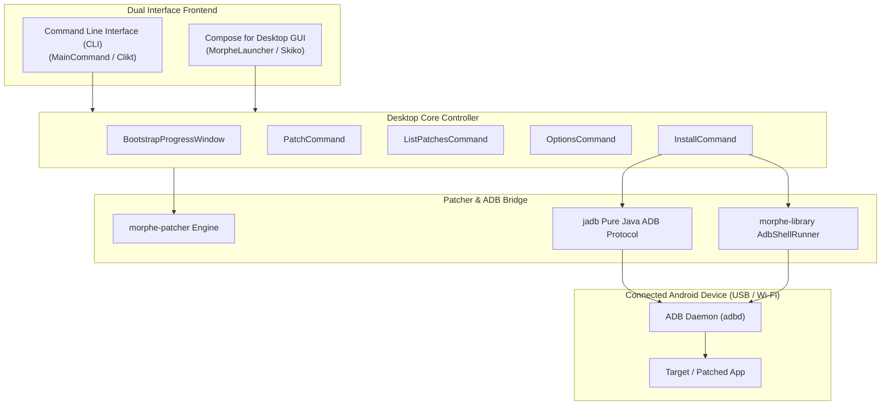

# Volume V: Chapter 2 — Morphe Desktop (CLI & GUI)

## 1. Overview & Dual Interface Architecture

**Morphe Desktop** ([`morphe-desktop`](https://github.com/MorpheApp/morphe-desktop)) is the official desktop cross-platform client of the Morphe ecosystem, designed for Windows, macOS, and Linux.

While `morphe-manager` runs on Android hardware, `morphe-desktop` offloads the patching workload to workstation CPUs. A patching job that takes 45–90 seconds on a mid-range phone completes in under 5 seconds on a desktop workstation.



---

## 2. CLI Command Suite

Morphe Desktop includes a powerful CLI utility for power users and CI/CD automated build pipelines:

### 1. `patch` Command
Applies selected patches to an input APK and emits a signed output APK:
```bash
morphe-desktop patch \
  --apk input-youtube.apk \
  --patches morphe-patches.mpp \
  --include "Video Ads" "Hide Shorts" "MicroG Support" \
  --options options.json \
  --out patched-youtube.apk \
  --install
```

### 2. `list-patches` Command
Inspects an `.mpp` bundle and outputs compatibility tables:
```bash
morphe-desktop list-patches --package com.google.android.youtube
```

### 3. `options` Command
Dumps all configurable keys, defaults, and descriptions for patches into a JSON schema template.

### 4. `install` Command
Directly sends any patched APK to connected devices using pure Java ADB socket protocols (`jadb`).

---

## 3. Compose for Desktop GUI

For users who prefer visual interaction on their PC:
- **Renderer:** Powered by JetBrains **Compose Multiplatform** and **Skiko** (Skia for Kotlin).
- **Bootstrap Flow (`BootstrapProgressWindow.kt`):** Automatically initializes the local JVM environment, downloads the latest `.mpp` bundle, and checks for connected Android devices over USB.
- **Drag-and-Drop:** Users can simply drag an APK file into the window, select patches with search filters, and click **Patch & Install**.

---

## 4. Pure Java ADB Bridge: `jadb` Integration

Morphe Desktop eliminates the requirement for users to manually install Google's Android SDK Platform Tools or configure `PATH` variables.

By embedding [`jadb`](https://github.com/MorpheApp/jadb) (a pure Java implementation of the ADB client protocol):
1. Morphe Desktop connects directly to the local ADB socket (`localhost:5037`) or starts an internal ADB daemon.
2. It detects device ABI architectures (`ro.product.cpu.abi`).
3. It pulls the installed base APK from the device directly if the user doesn't have an APK file:
   ```shell
   pm path com.google.android.youtube
   ```
4. After patching, it streams the APK over USB using `pm install -r -d` directly onto the device.
