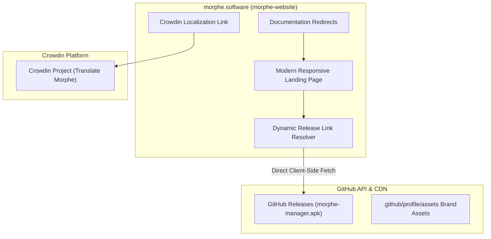

# Volume V: Chapter 3 — Morphe Website, Docs & Branding

## 1. Web Portal Architecture: `morphe-website`

The **Morphe Website** ([`morphe-website`](https://github.com/MorpheApp/morphe-website)) serves as the primary gateway at [https://morphe.software](https://morphe.software).

---

## 2. Privacy-First Distribution Design

Unlike commercial software websites laden with third-party trackers (Google Analytics, Facebook Pixel, tracking cookies), the Morphe website enforces strict privacy principles:
- **Zero Third-Party Telemetry:** No user analytics, no behavioral fingerprinting, and no IP logging.
- **Client-Side Asset Resolution:** Download links for `morphe-manager.apk` and `morphe-desktop` are resolved dynamically against the GitHub API using pure client-side JavaScript, ensuring that downloads come directly from GitHub releases without intermediary redirection proxies.

---

## 3. Community Documentation: `morphe-documentation`

The documentation repository ([`morphe-documentation`](https://github.com/MorpheApp/morphe-documentation)) acts as the user manual for non-technical users:
- **Troubleshooting & FAQs:** Comprehensive matrix resolving installation errors (e.g., `INSTALL_PARSE_FAILED_NO_CERTIFICATES`, `INSTALL_FAILED_UPDATE_INCOMPATIBLE`).
- **Step-by-Step Illustrated Guides:** Screenshots detailing how to enable "Install Unknown Apps" permissions, configure Shizuku, and authenticate Google accounts through MicroG-RE.

---

## 4. Brand Identity & Guidelines: `morphe-branding`

The visual assets of the project are standardized in [`morphe-branding`](https://github.com/MorpheApp/morphe-branding):
- **Logo Symbolism:** The stylized continuous ribbon and gradient pill motifs represent transformation (morphing) and digital sovereignty.
- **Color Palette:**
  - Teal Primary: `#00AFAE`
  - Emerald Secondary: `#1E5AA8`
  - Deep Dark Background: `#121212`
- **SVG Vector Assets:** Full suite of light and dark SVG wordmarks, icon vectors, and shields optimized for GitHub README banners and application splash screens.
