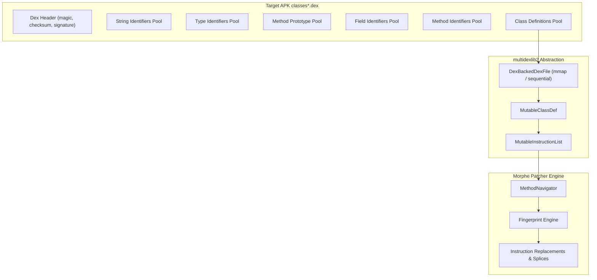

# Volume VI: Chapter 1 — Smali & Multidexlib2 Internals

## 1. The Dalvik Executable (DEX) Substrate

At the foundation of Android application execution is the **Dalvik Executable (`.dex`)** format. Android ART (Android Runtime) does not execute Java bytecode directly; it executes register-based 16-bit and 32-bit Dalvik instructions.

Morphe relies on two foundational libraries in Tier 5 to read, inspect, and write this format:
1. **`smali`** ([`MorpheApp/smali`](https://github.com/MorpheApp/smali)): Assembler/disassembler engine, forked to maintain compatibility with modern Android 14/15 DEX opcodes.
2. **`multidexlib2`** ([`MorpheApp/multidexlib2`](https://github.com/MorpheApp/multidexlib2)): High-performance, zero-overhead DEX inspection and mutation library.

---

## 2. Register Architecture & Opcode Format

Unlike JVM stack-based bytecode (`aload_0`, `invokevirtual`), Dalvik uses an explicit **register architecture**:
- `v0`, `v1`, `v2`, ... : Local scratch registers.
- `p0`, `p1`, `p2`, ... : Method parameter registers (`p0` is `this` in non-static methods).

### Instruction Formats:
Dalvik instructions are formatted in fixed bit structures:
- `10x`: 1-byte opcode with zero operands (e.g. `return-void`).
- `11x`: 1-byte opcode with one register operand (e.g. `return v0`).
- `21c`: 2-byte opcode with one register and one constant pool reference (e.g. `const-string v0, "morphe"`).
- `35c`: 3-byte opcode invoking a method with up to 5 register arguments (e.g. `invoke-virtual {v0, v1, v2}, Lmethod;->call()V`).

---

## 3. Multidex Challenges & Memory Caching

Commercial applications like YouTube are massive multi-dex APKs containing 10 to 15 separate `classes.dex` files:
1. **The 65,536 Method Reference Limit:** Android limits single DEX files to 64K method references.
2. **Dynamic Splitting:** When Morphe injects new extension classes, it must track whether the primary DEX (`classes.dex`) has room for new method IDs or if it needs to spill over into a newly created `classesN.dex`.
3. **Memory Mapping (`MappedFile`):**
   `multidexlib2` memory-maps large DEX files directly from disk into off-heap virtual memory (`mmap`). This ensures that scanning 80,000 classes across 12 DEX files does not exhaust Android's strict JVM heap limits (typically 256MB–512MB per process).
