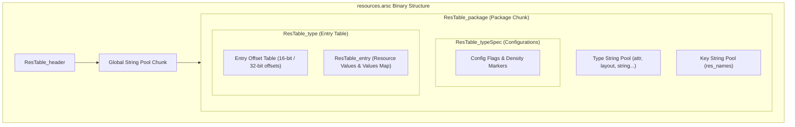

# Volume VI: Chapter 2 — ARSCLib & Binary Resource Manipulation

## 1. The Anatomy of Android Resources (`resources.arsc`)

Android resources are not stored as plain XML text inside an APK. During compilation by AAPT2, XML files are compiled into binary XML (`AXML`), and strings, dimensions, layouts, and IDs are assembled into a compiled binary resource table: `resources.arsc`.

Modifying resources (e.g. injecting new strings, altering view visibility attributes, replacing drawables) requires a dedicated parser. Morphe maintains a heavily optimized fork of **ARSCLib** ([`MorpheApp/ARSCLib`](https://github.com/MorpheApp/ARSCLib)).

---

## 2. Morphe's High-Performance Breakthroughs in ARSCLib

Standard ARSCLib implementations, while capable on high-spec workstations, regularly suffered catastrophic slowdowns and `OutOfMemoryError` crashes on physical Android phones.

The Morphe engineering team committed four fundamental architectural breakthroughs:

### 1. Lazy Allocation of Resource Entries & Offsets
- **The Problem:** Upstream ARSCLib eagerly instantiated `OffsetItem` and `Entry` objects for every slot in a resource table. In modern apps with dense tables, this allocated millions of empty objects, eating over 300MB of RAM.
- **The Morphe Fix:** Morphe reads entry offsets directly via an off-heap `ByteBuffer`. Empty resource slots serialize `NO_ENTRY` offsets directly without instantiating dummy Java objects, **saving hundreds of megabytes of heap memory**.

### 2. Eliminating Quadratic String Deduplication ($O(N^2) \rightarrow O(N \log N)$)
- **The Problem:** When removing unused locales or batch-sanitizing strings, thousands of keys collapsed into identical values. Upstream ARSCLib searched the entire list for duplicates and re-sorted on *every single insertion*, producing $O(N^2)$ complexity.
- **The Real-World Impact:** In apps with 88,000+ strings, string table re-indexing took **over 3 hours on a mobile phone!**
- **The Morphe Fix:** Morphe defers deduplication, sorting and deduplicating entries lazily when the table is read or serialized, dropping the execution time from hours to **less than 2 seconds**.

### 3. Native Memory Release on Close
- Explicitly frees off-heap native memory buffers associated with inflated entries when `close()` is called, preventing memory leaks during repeated patching sessions in Morphe Manager.

---

## 3. Dynamic Binary XML Manipulation

For UI layout modifications (such as hiding an ad container or changing an overlay icon):
1. `ARSCLib` parses binary XML chunks without converting them to human-readable XML text.
2. It navigates `ResXMLTree_node` elements directly.
3. It rewrites attributes (e.g. `android:visibility="gone"` or `android:layout_height="0dp"`) in the binary chunk in-place, avoiding the performance overhead of full XML re-serialization.
