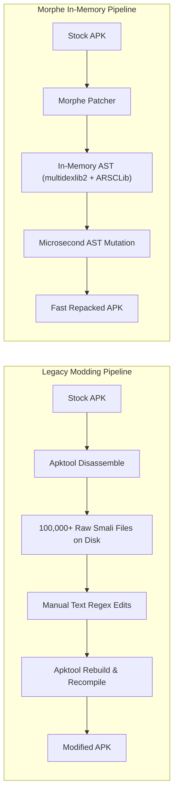
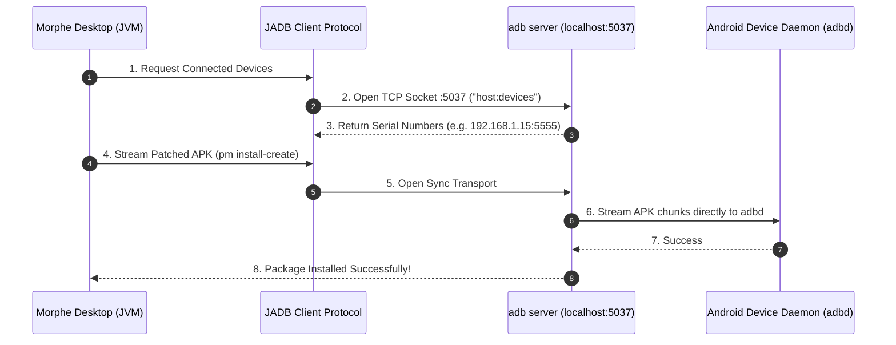

# Volume VI: Chapter 3 — Apktool & JADB Integration

## 1. The Role of Apktool in the Ecosystem

**Apktool** ([`MorpheApp/Apktool`](https://github.com/MorpheApp/Apktool)) is Connor Tumbleson's legendary tool for reverse engineering Android binary APKs.

### Why Morphe Moved Beyond Standalone Apktool:
While Apktool is indispensable for deep offline research and manual decompilation:
- Writing hundreds of thousands of loose `.smali` and `.xml` files to flash storage on an Android phone introduces severe I/O bottlenecks and disk wear.
- Morphe adopted the best of Apktool's resource logic into `ARSCLib`, migrating all bytecode operations directly into memory with `multidexlib2`.
- Morphe maintains its fork of Apktool to test new Android SDK features, split-APK decoding, and resource table edge-cases.

---

## 2. JADB: The Pure Java Android Debug Bridge

When executing on desktop computers (`morphe-desktop`), communicating with an Android device over USB or Wi-Fi is essential for pulling APKs and installing patched builds.

Rather than forcing users to install Google's official Android SDK Platform Tools (`adb.exe`), Morphe embeds **jadb** ([`MorpheApp/jadb`](https://github.com/MorpheApp/jadb)).

### Technical Capabilities of `jadb`:
1. **Zero External Dependencies:** Runs 100% within the JVM without external binary wrappers.
2. **Socket-Level Speed:** Communicates over TCP sockets using the native ADB sync and transport protocols.
3. **Split APK Streaming:** Supports streaming split APK bundles (`split_config.arm64_v8a.apk`, `base.apk`) in parallel.
