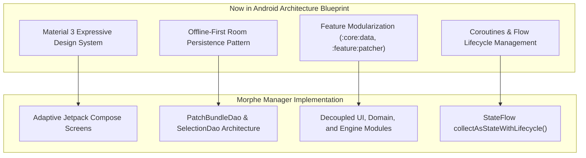

# Volume VI: Chapter 4 — NowInAndroid Blueprint & EJS Runtime

## 1. Architectural Guidance: The `nowinandroid` Fork

Google's **Now in Android** ([`MorpheApp/nowinandroid`](https://github.com/MorpheApp/nowinandroid)) is the industry benchmark for modern Android app architecture.

### Why Morphe Maintains this Fork:
1. **Architectural Blueprint:** `morphe-manager` directly adopted Now in Android's recommended patterns:
   - Unidirectional Data Flow (UDF) with immutable UI state.
   - Offline-first data layering where Room is the single source of truth.
   - Clean separation of UI logic from background patching coroutines.
2. **Component & Performance Testing:** Testing new Jetpack Compose compiler releases, baseline profiles, and R8 optimization flags in an isolated reference app before deploying to `morphe-manager`.

---

## 2. Dynamic Challenge Solving: The `ejs` Runtime

Modern media platforms often obfuscate streaming signatures using dynamic JavaScript functions (such as YouTube's `n-sig` cipher descrambling function, which changes daily).

Morphe maintains a fork of **ejs** ([`MorpheApp/ejs`](https://github.com/MorpheApp/ejs)), derived from the yt-dlp project:
- **Embedded JavaScript Engine:** Lightweight runtime capable of evaluating untrusted JavaScript challenge solvers across multiple host runtimes (QuickJS, V8, Duktape, or Android WebView).
- **Decoupled Cipher Solving:** Allows media extractor logic to execute dynamic JS functions in real time, calculating valid stream signatures without requiring hardcoded reverse-engineering patches for every daily JavaScript shift.
