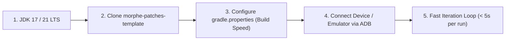
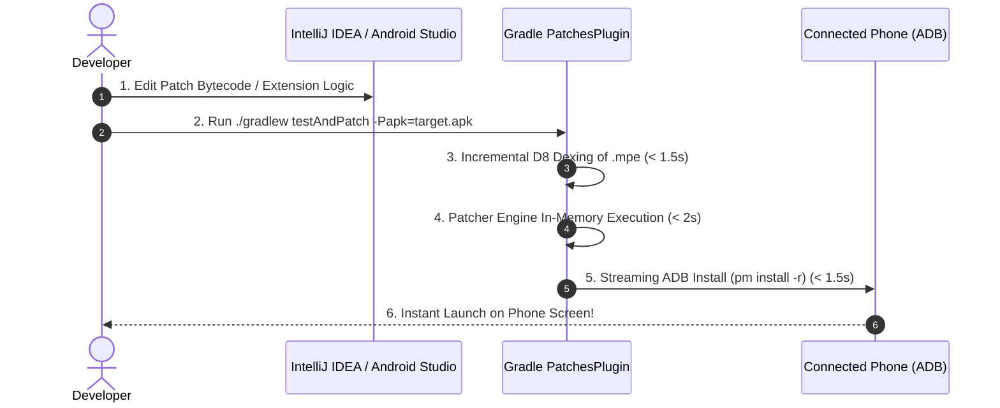

# Wiki: Developer Guide — Chapter 1: High-Velocity Patching Workflow

Welcome to the **Morphe Developer Wiki**! This section is engineered for patch authors, security researchers, and reverse engineers who want to author, test, and release robust patches with maximum execution speed and minimum friction.

---

## ⚡ The 5-Minute Developer Setup

To develop patches without waiting for slow builds, set up an optimized local environment:



### 1. Prerequisites
- **JDK:** Java 17 or Java 21 LTS (Azul Zulu or Temurin recommended).
- **Git & Android SDK:** Ensure `adb` is available on your shell `PATH`.
- **JADX-GUI:** The latest release of [JADX](https://github.com/skylot/jadx) with deobfuscation enabled.

### 2. Scaffold Your Patch Project
```bash
# Clone the official Morphe template
git clone https://github.com/MorpheApp/morphe-patches-template.git my-custom-patches
cd my-custom-patches
```

### 3. High-Performance Gradle Configuration (`gradle.properties`)
Accelerate compilation times by enabling the Gradle configuration cache and parallel builds:
```properties
# Enable parallel builds & daemon caching
org.gradle.parallel=true
org.gradle.caching=true
org.gradle.configuration-cache=true
org.gradle.jvmargs=-Xmx4g -XX:+UseG1GC -XX:+ParallelRefProcEnabled

# Android build cache
android.useAndroidX=true
```

---

## 🔁 The High-Speed Iteration Loop

Traditional modders waste minutes manually compiling, copying smali files, repacking, and signing. Morphe allows you to test code in **under 5 seconds**:



---

## 🧪 Local Unit Testing Harness

You do not need an actual Android phone to verify that your fingerprints match!

Create a fast JUnit 5 test in `patches/src/test/kotlin/`:
```kotlin
class FingerprintTest {
    @Test
    fun `verify all fingerprints match target YouTube APK`() {
        val testApk = File("src/test/resources/youtube-v19.16.apk")
        
        Patcher(PatcherConfig(apkFile = testApk)).use { patcher ->
            patcher += listOf(myCustomPatch)
            
            // Runs fingerprint matching without full APK repacking
            val unresolved = patcher.resolveFingerprints()
            
            assertTrue(unresolved.isEmpty(), "Unresolved fingerprints: $unresolved")
        }
    }
}
```
*Execution time:* **1.2 seconds** for 50+ fingerprints across 100,000 classes!
