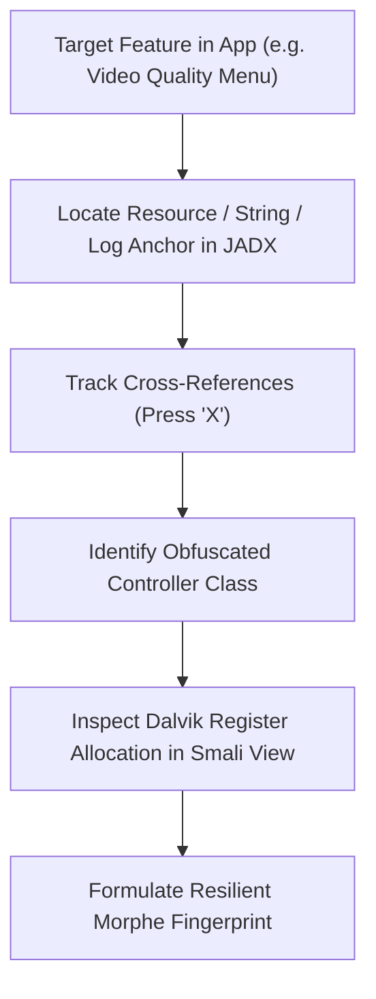

# Wiki: Developer Guide — Chapter 2: Reverse Engineering Toolchain

## 1. Navigating Obfuscated Codebases with Speed

Modern commercial Android apps (like YouTube and Reddit) are heavily obfuscated using **Google R8 / ProGuard**:
- Class names collapse to `a.b.c.a`, `d.e.f.b`.
- Method names collapse to `a()`, `b()`, `c()`.
- Unused methods and attributes are stripped or inlined.

To reverse-engineer these apps quickly, you must master the **invariant anchor methodology**.



---

## 2. Essential JADX-GUI Productivity Shortcuts

| Shortcut | Action | Developer Impact |
| :--- | :--- | :--- |
| <kbd>X</kbd> | **Find Usage (Cross References)** | Instantly trace where an obfuscated method or field is invoked across all 15 DEX files. |
| <kbd>R</kbd> | **Rename Identifier** | Renames obfuscated classes (`a.b.c`) locally in JADX to human-readable names (`VideoPlayerController`). |
| <kbd>G</kbd> | **Go to Class / Resource** | Rapidly jump to a known class or layout identifier without browsing folder trees. |
| <kbd>Tab</kbd> | **Switch to Smali View** | Toggles between high-level decompiled Java and raw Smali instructions to inspect register indices (`v0`, `p1`). |
| <kbd>Ctrl</kbd> + <kbd>Shift</kbd> + <kbd>F</kbd> | **Global Text & Hex Search** | Search raw strings, class signatures, or integer constants across the entire APK. |

---

## 3. Finding Invariant Anchors in 60 Seconds

When looking for where to inject your hook, look for **anchors that the R8 compiler cannot strip**:

### Anchor Type 1: User-Facing String Literals
String literals logged to Logcat or rendered on screens cannot be stripped without breaking application behavior:
```java
// Even when the class is obfuscated to "a.b.f", this string remains invariant:
Log.w("MediaRouteProvider", "Failed to acquire cast token: " + error);
```

### Anchor Type 2: Android Framework Callbacks
Methods overriding Android SDK interfaces must preserve their exact signatures and parameter types:
```java
// Method signature cannot be obfuscated because it implements View.OnClickListener:
public void onClick(View v) { ... }
```

### Anchor Type 3: Proto Identifiers & Tag Numbers
Protocol Buffer serializers rely on fixed field numbers:
```java
// Field tags (e.g. tag 4, tag 18) remain identical across app versions
if (protoReader.readTag() == 18) { ... }
```

---

## 4. Smali Register Inspection Before Patching

Before authoring your Kotlin patch, press <kbd>Tab</kbd> in JADX to view the Smali representation:

```smali
.method public final renderBanner(Landroid/view/View;Z)V
    .registers 5
    .param p1, "view"    # Landroid/view/View;
    .param p2, "visible" # Z

    # p0 = this
    # p1 = view
    # p2 = visible
    # v0, v1 = locals

    if-eqz p2, :cond_show
    const/16 v0, 0x8
    invoke-virtual {p1, v0}, Landroid/view/View;->setVisibility(I)V
    return-void

    :cond_show
    const/4 v0, 0x0
    invoke-virtual {p1, v0}, Landroid/view/View;->setVisibility(I)V
    return-void
.end method
```

By inspecting this:
1. You identify that `p1` holds the `View` object.
2. You identify that replacing `const/4 v0, 0x0` with `const/16 v0, 0x8` permanently hides the banner with zero overhead!
