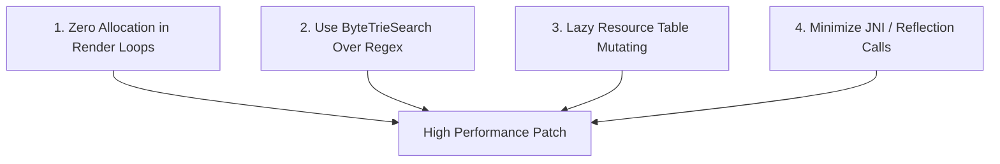

# Wiki: Developer Guide — Chapter 3: Writing Lightning-Fast Patches

## 1. Performance Guidelines for Patch Authors

When your patch runs inside an application like YouTube (which executes hundreds of animation and audio frames per second), **inefficient code causes perceptible UI lag and stutter**.

To ensure 60 to 120 FPS performance, follow these four engineering commandments:



---

## 2. Rule 1: Zero Allocation in Render & Audio Loops

Never instantiate new objects (`new String()`, `new ArrayList()`, or lambda closures) inside methods called per-frame (e.g. `onDraw()`, `onScrolled()`, `onTimeUpdate()`).

```java
// ❌ BAD: Allocates a new String and regex matcher every 100ms
public void onTimeUpdate(long timeMs) {
    String formatted = String.format("%02d:%02d", timeMs / 60000, (timeMs % 60000) / 1000);
    if (formatted.matches(".*[0-9]+.*")) { ... }
}

// ✅ GOOD: Uses primitive comparisons and pre-allocated buffers
private static final StringBuilder buffer = new StringBuilder(16);

public static synchronized void onTimeUpdate(long timeMs) {
    buffer.setLength(0);
    // Append primitives without object churn
}
```

---

## 3. Rule 2: ByteTrieSearch Over String Regex

When filtering network streams, JSON bodies, or Protobuf payloads:
- `java.util.regex.Pattern` compiles nondeterministic finite automata (NFA) with backtracking, which stalls the calling thread.
- Standard string checks require converting raw network bytes into UTF-16 `java.lang.String` objects first.

Instead, use **`ByteTrieSearch`** from `morphe-patches-library`:
```java
import app.morphe.extension.shared.ByteTrieSearch;

public class StreamFilter {
    private static final ByteTrieSearch trie = new ByteTrieSearch();

    static {
        trie.addPatterns(ByteTrieSearch.convertStringsToBytes(
            "ad_placement",
            "sponsored_card",
            "interstitial"
        ));
    }

    public static boolean containsAd(byte[] buffer, int offset, int length) {
        // Traverses the byte slice directly in O(N) time with ZERO allocations!
        return trie.search(buffer, offset, length);
    }
}
```

---

## 4. Rule 3: Lazy Resource Decoding in Patcher 2.0

When authoring resource patches in Kotlin:
- Do not call `get("res").listFiles()`—this triggers eager decoding of thousands of files across all languages and DPI buckets!
- Instead, use specific glob patterns with `decode(...)`:

```kotlin
// ❌ SLOW: Eagerly decodes all resources in the APK
context.resourceDirectory.listFiles { ... }

// ✅ FAST: Lazily decodes ONLY the values directory needed
decode("res/values/strings.xml").forEach { path ->
    document(path).use { xml ->
        xml.findOrCreateElement("string", "name" to "morphe_custom_label").text = "My Patch"
    }
}
```

---

## 5. Rule 4: Dynamic Resource ID Resolution Caching

Because `ResourceUtils.getIdentifier()` queries Android's `AssetManager` via JNI, calling it repeatedly inside view scrolling callbacks causes micro-stutters.

Always cache resolved integer IDs in static fields:
```java
public class ViewHook {
    private static int cachedLayoutId = -1;

    public static void onBind(View parent) {
        if (cachedLayoutId == -1) {
            cachedLayoutId = ResourceUtils.getIdentifier(ResourceType.LAYOUT, "custom_overlay");
        }
        View customView = parent.findViewById(cachedLayoutId);
    }
}
```
