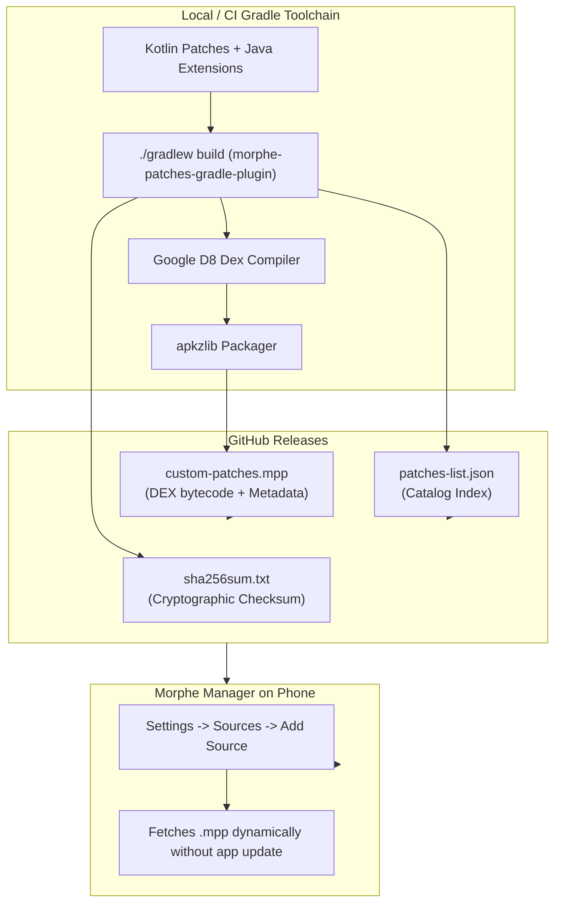

# Wiki: Developer Guide — Chapter 4: Building & Publishing Patch Bundles

## 1. Bundle Lifecycle & Container Architecture

When you share your patches with the community, you do not distribute source code files; you distribute a compiled **Morphe Patch Package (`.mpp`)** and an index manifest (`patches-list.json`).



---

## 2. Compiling the Bundle via Gradle

In your patch project root, execute:
```bash
./gradlew build
```

This task automatically executes:
1. `compileKotlin`: Compiles patch definitions and fingerprints into JVM bytecode.
2. `dexExtensions`: Invokes Google D8 to compile all `extensions/**` into standalone Dalvik Executables (`.mpe`).
3. `generatePatchList`: Walks all registered `bytecodePatch` objects and serializes metadata (name, description, target packages, version targets, options) into `patches-list.json`.
4. `packageMpp`: Combines the compiled `.class` files, `.mpe` assets, and manifest into `build/libs/my-patches-v1.0.0.mpp`.

---

## 3. Automated CI/CD Release with GitHub Actions

Add this workflow file at `.github/workflows/release.yml` in your repository:

```yaml
name: Release Patch Bundle

on:
  push:
    tags:
      - 'v*'

jobs:
  build-and-release:
    runs-on: ubuntu-latest
    steps:
      - name: Checkout Code
        uses: actions/checkout@v4

      - name: Setup JDK 21
        uses: actions/setup-java@v4
        with:
          distribution: 'temurin'
          java-version: '21'

      - name: Grant Execute Permissions
        run: chmod +x gradlew

      - name: Build Patch Bundle
        run: ./gradlew build

      - name: Generate Checksums
        run: |
          cd patches/build/libs/
          sha256sum *.mpp > sha256sum.txt

      - name: Create GitHub Release
        uses: softprops/action-gh-release@v2
        with:
          files: |
            patches/build/libs/*.mpp
            patches/build/libs/patches-list.json
            patches/build/libs/sha256sum.txt
        env:
          GITHUB_TOKEN: ${{ secrets.GITHUB_TOKEN }}
```

---

## 4. Distributing to Morphe Manager Users

Once your release is published on GitHub, anyone can use your patches:
1. Provide users with your repository link (e.g. `https://github.com/your-username/my-patches`).
2. Inside **Morphe Manager**:
   - Go to **Settings** $\rightarrow$ **Sources**.
   - Tap **Add Source (+)**.
   - Enter your repository URL.
3. Morphe Manager immediately indexes your `patches-list.json`, downloads your `.mpp` bundle, and lists your patches in the patch selection list!
