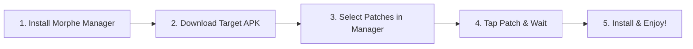

# Wiki: User Guide — Chapter 1: Quick Start Guide

Welcome to the **Morphe User Wiki**! This guide is designed to take any Android user—regardless of technical background—from zero to having fully functioning, ad-free, enhanced applications running on their phone in less than 5 minutes.

---

## 🎯 What You Need Before You Start

1. **An Android Device:** Running Android 8.0 (Oreo) or newer.
2. **Morphe Manager:** The official patcher application.
3. **Target App APK:** The clean, unmodified stock APK of the app you want to patch (e.g. YouTube, YouTube Music, or Reddit).
4. **MicroG-RE (For Non-Root Users):** If you want to log in to your Google Account on patched YouTube or YouTube Music.

---

## 📥 Step 1: Download & Install Morphe Manager

1. Open your browser and navigate to the official Morphe portal: [https://morphe.software](https://morphe.software) (or download directly from [Morphe Manager Releases](https://github.com/MorpheApp/morphe-manager/releases)).
2. Download the latest `morphe-manager-vX.X.X.apk`.
3. Open the downloaded APK. If prompted with *"For your security, your phone is not allowed to install unknown apps from this source"*, tap **Settings** and toggle **Allow from this source**.
4. Tap **Install** and open **Morphe Manager**.

---

## 📦 Step 2: Obtain the Clean Target APK

> [!IMPORTANT]
> **Do not patch the YouTube app pre-installed from Google Play Store directly** unless you are using **Root Mode**. Android restricts modifying pre-installed system apps without root. Instead, download a standalone APK file.

1. In Morphe Manager, tap the **Patcher** tab at the bottom.
2. Tap **Select an application**.
3. Under the app you want to patch (e.g., **YouTube**), note the **Suggested Version** (e.g., `19.16.39`).
4. Download the non-bundle APK corresponding to that exact suggested version from a reputable mirror such as [APKMirror](https://www.apkmirror.com).
   - Ensure you download the variant marked **APK** (not "BUNDLE" / "APKMs").
   - Target the `universal` or `arm64-v8a` architecture.

---

## 🧩 Step 3: Select Your Patches

1. Return to **Morphe Manager** $\rightarrow$ **Patcher** tab.
2. Tap **Storage** in the bottom-right corner and choose the APK file you just downloaded.
3. Morphe Manager will parse the APK and display the patch selection screen:
   - Tap **Selected patches** to view what is included.
   - **Recommended Preset:** Automatically selects essential patches (Ad blocking, SponsorBlock, Background Playback, MicroG support, Return YouTube Dislike).
   - **Customization:** Toggle any individual patch on or off. Tap the gear icon next to a patch to configure settings (such as custom themes or default video speeds).

---

## ⚡ Step 4: Patch the App

1. Tap the **Patch** button in the lower-right corner.
2. Morphe Manager will execute the patching engine directly on your device:
   - *Parsing DEX headers and class definitions.*
   - *Decoding AndroidManifest and resources.*
   - *Applying bytecode mutations and merging extensions.*
   - *Compiling and signing the new APK with your local keystore.*
3. The process takes between **30 to 60 seconds** depending on your phone's processor speed.

---

## 📲 Step 5: Install and Launch

1. Once the log reads **Finished!**, tap the **Install** button.
2. If using standard non-root mode, Android will display the package installer prompt. Confirm the installation.
3. If patching YouTube or YouTube Music, proceed to [**Chapter 2: MicroG-RE & Account Setup**](02-microg-and-account-setup.md) to log in to your account.
