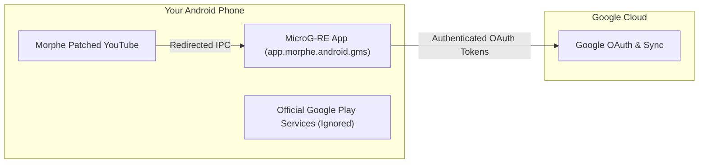

# Wiki: User Guide — Chapter 2: MicroG-RE & Account Setup

## 1. Why is MicroG-RE Necessary?

When you patch YouTube or YouTube Music on a non-rooted device:
- The app's package name is changed (to `app.morphe.android.youtube`) or its cryptographic signature is changed.
- The official Google Play Services (`com.google.android.gms`) running on your phone will reject all authentication and sync requests from modified signatures.
- **MicroG-RE** is a standalone, lightweight replacement for Google Play Services designed specifically to grant Morphe apps full access to Google accounts, watch histories, playlists, and subscriptions without root.

---

## 2. Installing MicroG-RE

1. Download the latest **MicroG-RE** APK from [MorpheApp/MicroG-RE Releases](https://github.com/MorpheApp/MicroG-RE/releases) or directly within Morphe Manager.
2. Choose the release for your device:
   - **`microg-arm64-v8a.apk` (Recommended):** Optimized for 95%+ of modern smartphones (smaller size, faster startup).
   - **`microg-universal.apk`:** Compatible with all Android architectures.
3. Install the APK like any standard Android application.

---

## 3. Disabling OEM Battery Optimization (Critical Step)

Aggressive OEM battery managers frequently kill background MicroG services, causing notifications to fail or playback to disconnect.

### Platform-Specific Instructions:

#### 📱 Samsung (One UI):
1. Go to **Settings** $\rightarrow$ **Apps** $\rightarrow$ **MicroG Services**.
2. Tap **Battery** $\rightarrow$ select **Unrestricted**.
3. Under **Settings** $\rightarrow$ **Battery and Device Care** $\rightarrow$ **Background usage limits**, ensure MicroG is in **Never sleeping apps**.

#### 📱 Xiaomi / Redmi / POCO (MIUI / HyperOS):
1. Long-press the **MicroG Services** icon $\rightarrow$ tap **App info**.
2. Enable **Autostart**.
3. Under **Battery saver**, select **No restrictions**.
4. In **Other permissions**, allow **Display pop-up windows while running in the background**.

#### 📱 OnePlus / OPPO / Realme (OxygenOS / ColorOS):
1. Go to **Settings** $\rightarrow$ **Apps** $\rightarrow$ **MicroG Services** $\rightarrow$ **Battery usage**.
2. Enable **Allow background activity** and **Allow auto-launch**.

---

## 4. Logging in to Your Google Account

1. Open your freshly patched **Morphe YouTube** or **YouTube Music** app.
2. Tap the **Account Avatar** in the top-right corner $\rightarrow$ tap **Sign In**.
3. Tap **Add account (+)**. The app will launch the MicroG login screen.
4. Enter your Google email and password. Complete 2-Factor Authentication (2FA) if prompted.
5. Once complete, your subscriptions, library, and watch history will populate instantly!

---

## 5. Troubleshooting Account Sync Issues

| Issue | Cause | Fix |
| :--- | :--- | :--- |
| **"Please check your network connection"** | Outdated or mismatched MicroG build | Uninstall MicroG-RE, restart phone, install latest release from GitHub. |
| **Infinite loading spinner on sign-in** | Google Play Protect or Chrome autofill collision | Temporarily disable Chrome autofill during login, or sign in via browser prompt. |
| **History not updating** | Brand account or ad-block DNS | Ensure you are logged into your primary Google profile, or whitelist `s.youtube.com` in your Private DNS / Pi-hole. |
