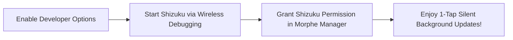

# Wiki: User Guide — Chapter 3: Root vs. Non-Root Installation Modes

Morphe supports three distinct deployment modes on Android. Choosing the optimal mode depends on your device privileges and preferences:

---

## ⚖️ Comparative Feature Matrix

| Feature | 1. Standard Non-Root | 2. Shizuku Rootless | 3. Root Bind Mount |
| :--- | :--- | :--- | :--- |
| **Requires Root?** | ❌ No | ❌ No | ✅ Yes (Magisk / KSU / APatch) |
| **Requires MicroG?** | ✅ Yes | ✅ Yes | ❌ No (Uses real Google Play Services) |
| **Installation Prompts** | Manual tap required | ⚡ Silent (1-tap background) | ⚡ Instant direct mount |
| **Google Cast Support** | Limited / DIAL fallback | Limited / DIAL fallback | 🌟 Full native Cast v3 |
| **Keeps Stock Package Name** | ❌ Renamed (`app.morphe...`) | ❌ Renamed (`app.morphe...`) | ✅ Original (`com.google...`) |
| **Play Store Incompatibility** | None (Isolated) | None (Isolated) | Must detach or freeze Play updates |

---

## 🛠️ Mode 1: Standard Non-Root (Default)

The simplest, zero-risk method that requires no special setup.

1. In Morphe Manager, leave **Installer** set to **Default / Session Installer**.
2. Select your APK, apply patches, and tap **Install**.
3. When prompted by Android, tap **Install** or **Update**.
4. Uses MicroG-RE for Google account features.

---

## ⚡ Mode 2: Shizuku Rootless Privileged Mode

If you do not have root, but want **silent, automated one-tap updates** without clicking through Android's system package installer sheets every time:

### Setup Steps:
1. Install [Shizuku](https://shizuku.rikka.app/) from Google Play or GitHub.
2. Enable **Developer Options** on your phone:
   - Go to **Settings** $\rightarrow$ **About Phone** $\rightarrow$ tap **Build Number** 7 times.
3. Open **Developer Options**:
   - Enable **Wireless Debugging**.
4. Open the Shizuku app:
   - Tap **Pairing** $\rightarrow$ enter the 6-digit wireless pairing code.
   - Tap **Start**. Shizuku will start running under ADB permissions (UID 2000).
5. Open **Morphe Manager** $\rightarrow$ **Settings** $\rightarrow$ **Installer**:
   - Select **Shizuku**.
   - Tap **Allow all the time** when the permission prompt appears.
6. Now, whenever you patch an app, Morphe Manager installs it silently in the background!

---

## 👑 Mode 3: Root Bind Mount (Magisk / KernelSU / APatch)

For rooted users who want the purest native Android integration:

### Why Root Bind Mount is Superior:
- Retains the official package name (`com.google.android.youtube`).
- Google Play Services, Assistant, and Cast v3 work natively out of the box without MicroG.
- Deep links (opening YouTube links from WhatsApp, Reddit, or Twitter) launch directly without configuration.

### Setup Steps:
1. Ensure your device is rooted with **Magisk (v25+)**, **KernelSU**, or **APatch**.
2. In Morphe Manager $\rightarrow$ **Settings** $\rightarrow$ **Installer**, select **Root / Mount Installer**.
3. Grant Superuser permissions when the prompt appears.
4. When patching YouTube, **uncheck the MicroG Support patch** (it is not needed in Root mode).
5. Tap **Patch** $\rightarrow$ Morphe Manager will mount the modified APK directly over `/data/app` using `libsu`.
6. Reboot or force-close the stock app to apply changes!
