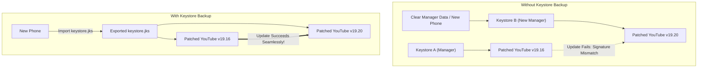

# Wiki: User Guide — Chapter 4: Exporting, Importing & Keystores

## 1. The Keystore Dilemma: Avoiding `INSTALL_FAILED_UPDATE_INCOMPATIBLE`

When Morphe Manager patches an APK, it cryptographically signs the final APK with a locally generated RSA keystore.

> [!WARNING]
> **Android Signature Invariant:** Android requires that every application update be signed with the **exact same cryptographic key** as the currently installed version. If you clear Morphe Manager's app data, reinstall Manager, or switch to a new phone, Manager will generate a *new* keystore. Subsequent updates will fail with:
> `App not installed as package appears to be invalid` or `INSTALL_FAILED_UPDATE_INCOMPATIBLE`.

---

## 2. How to Export & Back Up Your Keystore

1. Open **Morphe Manager** $\rightarrow$ tap the **Settings** icon (top right).
2. Scroll to the **Security & Keystore** section.
3. Tap **Export Keystore**.
4. Save the generated `.jks` or `.keystore` file to a secure location (such as Google Drive, Proton Drive, or local storage).

### How to Restore on a New Device:
1. On your new phone, install Morphe Manager.
2. Go to **Settings** $\rightarrow$ **Security & Keystore** $\rightarrow$ tap **Import Keystore**.
3. Select your saved `.jks` file.
4. Now, all future patches will use your original cryptographic key!

---

## 3. Exporting Patched APKs

If you want to save the patched APK to your storage or share it across multiple family devices:

1. On the **Patcher** screen after patching completes:
   - Notice the three-dot menu or save icon next to the **Install** button.
   - Tap **Export APK** (or **Save to Storage**).
2. Select your destination directory (e.g., `Downloads/`).
3. You can now transfer this APK to an Android TV, tablet, or secondary phone without re-patching!

---

## 4. Batch Patching Multiple Applications

Morphe Manager includes a **Batch Patcher** screen designed to update all your apps in one automated job:
1. Tap the **Batch Patcher** tab or icon.
2. Select all target apps you wish to patch:
   - ✅ *YouTube*
   - ✅ *YouTube Music*
   - ✅ *Reddit*
3. Provide the input APK files.
4. Tap **Start Batch Patching**.
5. Morphe Manager queues each application, executes the AST mutations sequentially, and prompts you to install all three when complete.
